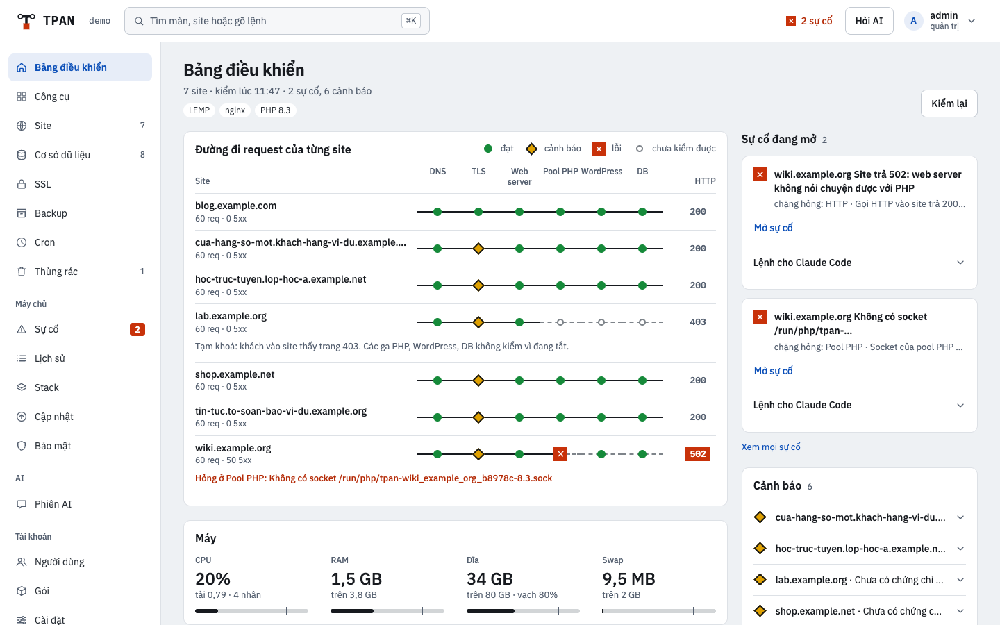
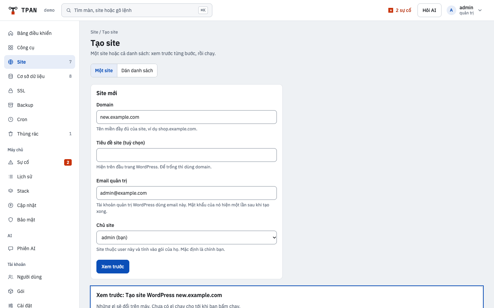
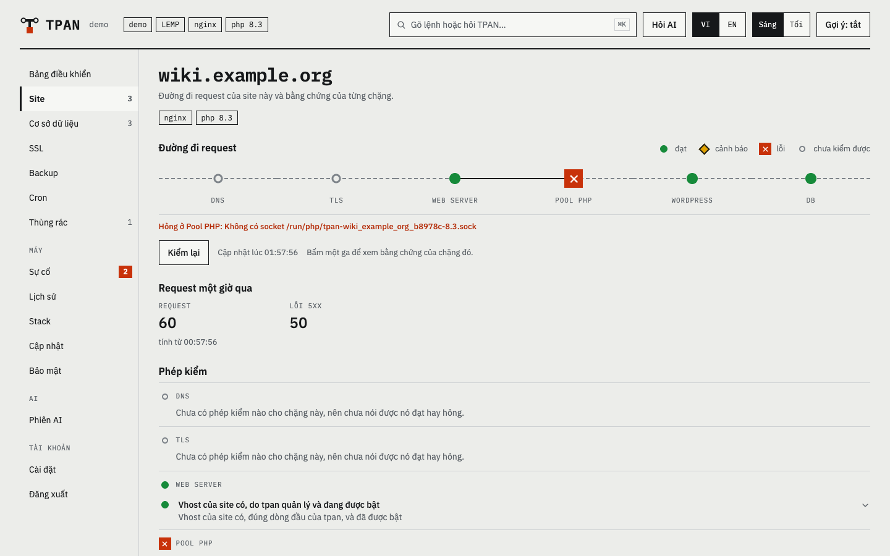
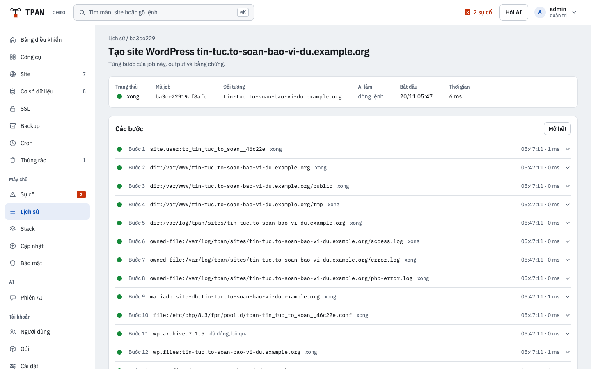
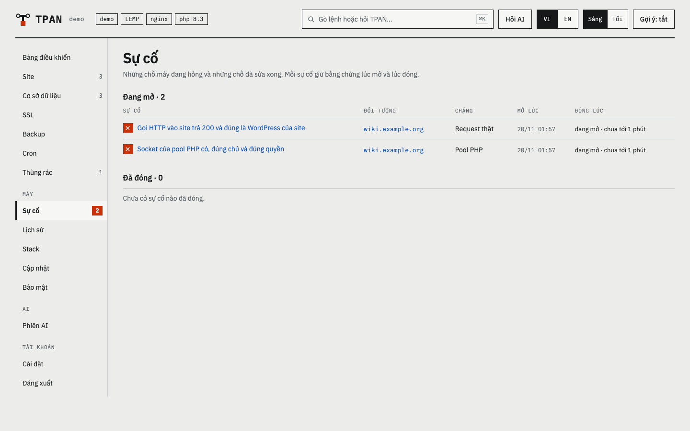
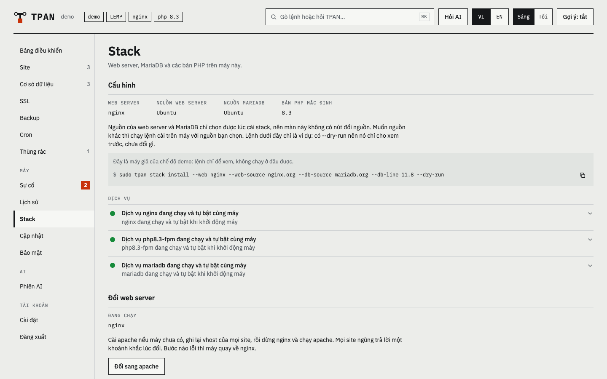
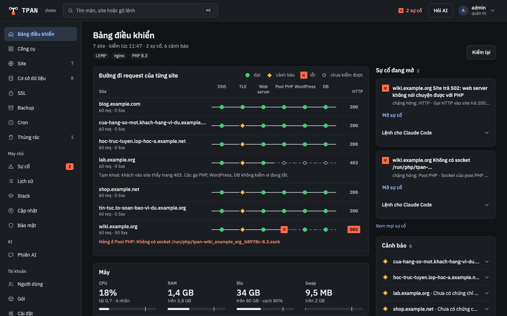

# TPAN

[](https://github.com/doxuta/tpan/releases/latest)
[](LICENSE)

TPAN là panel quản trị máy chủ web cho một VPS Ubuntu 24.04. Nó làm hai việc: cài LEMP (nginx) hoặc LAMP (apache), và tạo nhiều site WordPress trên cùng một máy, mỗi site một tên miền. Mọi thứ nằm trong một file chạy `tpan` viết bằng Go, có CLI, API, giao diện web song ngữ Việt và Anh, và cổng MCP cho agent.

Khác với panel kiểu "bấm là chạy", TPAN làm theo kiểu hộp kính:

- Xem trước: mọi thao tác hiện danh sách bước, lệnh sẽ chạy và file sẽ ghi (có diff) trước khi chạy.
- Hoàn tác: bước nào lỗi thì các bước đã chạy được gỡ lại theo thứ tự ngược; config luôn được kiểm (`nginx -t`, `apachectl configtest`) trước khi reload.
- Kiểm chứng: thao tác kết thúc bằng bước kiểm và lưu bằng chứng (mã HTTP, socket, quyền file, hạn chứng chỉ).
- Cô lập từng site: user Linux riêng, pool PHP-FPM riêng, DB và user DB riêng.
- Health theo đường đi request: DNS, TLS, web server, pool PHP, WordPress, DB. Site hỏng thì chỉ ra đúng chặng hỏng kèm bằng chứng và cách sửa.
- AI không có tay: AI (tuỳ chọn, tắt mặc định) chỉ đọc và đề xuất một Plan; người duyệt trên bản xem trước rồi TPAN mới chạy. Bộ não là Claude Code trên máy của người vận hành, máy chủ không giữ khoá AI nào.

Thiết kế đầy đủ ở [docs/KE-HOACH.md](docs/KE-HOACH.md), mục 1 và 2.

## Ảnh

Mọi ảnh dưới đây chụp từ `tpan serve --demo`: một máy giả có dữ liệu mẫu (tên máy `demo`, các site `*.example.*`), không phải máy thật. Chụp lại bằng `go run ./scripts/anh-readme`.



Bảng điều khiển: mỗi site một dòng theo đường đi request. Ở đây `wiki.example.org` hỏng ở chặng Pool PHP (không có socket), nên trả 502; cột phải là các sự cố đang mở.



Tạo site: bấm "Xem trước" thì thấy số bước sẽ chạy, bước bỏ qua vì máy đã đúng, và các file sẽ đổi. Chưa có gì chạy cho tới khi bấm chạy.



Trang của một site: đường đi request, chặng hỏng, số request và lỗi 5xx trong một giờ, rồi từng phép kiểm theo chặng.



Một job tạo site: từng bước, trạng thái (xong, đã đúng nên bỏ qua), thời gian, và bằng chứng của từng bước.



Sự cố: những chỗ đang hỏng và đã sửa xong, mỗi sự cố giữ bằng chứng lúc mở và lúc đóng.



Stack: web server, nguồn gói, bản PHP mặc định, trạng thái ba dịch vụ, và nút chuyển nginx sang apache tại chỗ.



Cùng bảng điều khiển ở giao diện tối.

## Cảnh báo

TPAN chạy bằng quyền root và sửa cấu hình hệ thống (gói apt, nginx hoặc apache, PHP-FPM, MariaDB, user Linux, cron). Chỉ cài trên một VPS Ubuntu 24.04 sạch dành riêng cho nó, không cài lên máy đang chạy dịch vụ khác. Luôn thử trên máy ảo trước (phần Phát triển bên dưới có máy ảo test).

## Yêu cầu

- Ubuntu 24.04 LTS sạch, amd64 hoặc arm64, quyền root (hoặc user có sudo).
- Đã chạy thật trên: VPS 4 vCPU, 6 GB RAM, đĩa 40 GB (amd64); máy ảo 2 CPU, 4 GB RAM, đĩa 20 GB (arm64).
- Mở cổng 22 (SSH), 80 và 443 (site), 8443 (panel). Muốn panel không ra internet thì cài với `--private`.
- Muốn có HTTPS thật cho site: một tên miền có bản ghi A trỏ về IP của máy.

## Cài đặt

Cài trên một VPS Ubuntu 24.04 sạch, từ bản phát hành mới nhất trên GitHub:

```bash
curl -fsSL https://github.com/doxuta/tpan/releases/latest/download/install.sh | sudo bash -s -- --web nginx
```

Đổi `--web nginx` (LEMP) thành `--web apache` nếu muốn LAMP. Script cài là `scripts/install.sh`. Nó đặt file chạy vào `/usr/local/bin/tpan`, chạy `tpan setup` (thư mục, chứng chỉ tự ký, DB, mật khẩu quản trị, dịch vụ systemd), rồi nếu có `--web` thì chạy `tpan stack install`. Chạy lại được: thứ gì đã đúng thì không đổi.

Các cờ, lấy từ `bash scripts/install.sh --help`:

```
sudo ./install.sh [--binary FILE | --from BASE] [--private] [--web nginx|apache]
                  [--force] [--check-only] [--lang vi|en]

--binary FILE   dùng file chạy có sẵn
--from BASE     tải tpan-linux-<arch> và SHA256SUMS từ BASE (https)
--private       panel chỉ nghe 127.0.0.1
--web W         cài thêm stack: nginx (LEMP) hoặc apache (LAMP)
--force         bỏ qua kiểm Ubuntu 24.04 (rủi ro)
--check-only    chỉ tìm hoặc tải file chạy và kiểm sha256, không cài gì
--lang vi|en    ngôn ngữ thông báo
```

### Thử cả gói bằng một lệnh

Trên VPS sạch, lệnh này cài tpan rồi tự thử lần lượt: health, tạo site `thu.example.com`, thùng rác, fail2ban, ufw, backup, đổi nginx sang apache rồi về, PHP, cập nhật. Cuối cùng in bảng đạt/hỏng; log đã che mật khẩu và IP nằm ở `/root/tpan-thu-che.log`.

```bash
curl -fsSL https://raw.githubusercontent.com/doxuta/tpan/main/scripts/thu-tren-vps.sh | sudo bash
```

### Cài không qua GitHub: chép gói phát hành sang máy

Dùng khi máy đích không tải được từ GitHub, hoặc khi thử bản tự build. Trên máy dev, đóng gói:

```bash
make release
```

Gói nằm ở `dist/release/<bản>/`, gồm `tpan-linux-amd64`, `tpan-linux-arm64`, `install.sh` và `SHA256SUMS`. `<bản>` lấy từ `git describe`, chưa có tag thì là mã commit.

Chép cả thư mục sang máy đích rồi chạy trên máy đích:

```bash
# trên Mac
scp -r dist/release/<bản> <user>@<máy>:tpan-release

# trên máy đích
cd tpan-release
sudo ./install.sh --web nginx        # hoặc --web apache
```

`install.sh` tự chọn `tpan-linux-amd64` hay `tpan-linux-arm64` theo máy, kiểm sha256 với `SHA256SUMS` nằm cạnh, và thử chạy `tpan version` trước khi thay file. Gói đặt trên một máy chủ nội bộ thì dùng `<BASE>/install.sh` kèm `--from <BASE>`.

### Sau khi cài

1. Lúc chạy, `tpan setup` in ra địa chỉ panel, dấu vân tay SHA-256 của chứng chỉ, và mật khẩu quản trị. Mật khẩu chỉ hiện một lần: lưu lại ngay.
2. Mở `https://<IP của máy>:8443`. Trình duyệt sẽ cảnh báo vì chứng chỉ tự ký. Xem chi tiết chứng chỉ trong trình duyệt và so dấu vân tay SHA-256 với dòng `tpan setup` đã in. Khớp thì đúng là panel của bạn, lúc đó mới bỏ qua cảnh báo.
3. Đăng nhập bằng mật khẩu vừa lưu.
4. Bật lịch backup: `sudo tpan backup settings --keep 5 --at 03:30`. Máy mới chưa có bản sao lưu nào của `tpan.db`, nên trang Sự cố và `tpan health` sẽ cảnh báo `tpan.backup:db` cho tới khi có (đó là cảnh báo thật, không phải lỗi).
5. Tạo site đầu tiên ở màn **Site → Tạo site**, hoặc bằng CLI ở phần dưới. Xin HTTPS ở màn **SSL**: mặc định là chứng chỉ thử (staging) của Let's Encrypt, không tốn hạn mức nhưng trình duyệt chưa tin; thử xong thì tắt Staging và bấm "Xin lại" để có chứng chỉ thật.

Cập nhật lên bản mới: `sudo tpan self-update --dry-run` để xem trước, `sudo tpan self-update --yes` để cập nhật (giữ bản cũ, quay lại bằng `--rollback`).

Quên mật khẩu: trên máy chủ chạy `sudo tpan admin passwd`. Lệnh này sinh mật khẩu mới, huỷ mọi phiên đăng nhập và gỡ mọi IP đang bị khoá.

Chế độ riêng tư: cài với `--private` (hoặc chạy `sudo tpan setup --private`) thì panel chỉ nghe `127.0.0.1`, không mở cổng ra internet. Vào bằng đường hầm SSH từ máy của bạn:

```bash
ssh -L 8443:127.0.0.1:8443 <user>@<máy>
# rồi mở https://127.0.0.1:8443
```

## Dùng nhanh bằng CLI

Các lệnh dưới chạy trên máy chủ. Các lệnh cài, tạo, sửa hay gỡ thứ gì trên máy đều có `--dry-run` (chỉ in kế hoạch, không đổi gì) và `--yes` (không hỏi xác nhận). Xem đủ cờ bằng `tpan <lệnh> --help`.

```bash
# Stack
sudo tpan stack install --web nginx            # LEMP; --web apache cho LAMP
sudo tpan stack status
sudo tpan stack switch --to apache --dry-run   # xem trước việc chuyển nginx sang apache tại chỗ

# Site WordPress
sudo tpan site add shop.example.com --email admin@example.com
sudo tpan site list
sudo tpan site info shop.example.com
sudo tpan site rm shop.example.com             # vào thùng rác, khôi phục bằng: sudo tpan site restore shop.example.com

# Health
sudo tpan health                               # mọi phép kiểm; mã thoát 1 khi có lỗi
sudo tpan health shop.example.com --fix --dry-run

# SSL (Let's Encrypt, cần tên miền thật trỏ về máy)
sudo tpan ssl issue shop.example.com --email admin@example.com   # mặc định là chứng chỉ thử (staging)
sudo tpan ssl settings --staging=false                           # thử xong: từ giờ xin chứng chỉ thật
sudo tpan site add blog.example.com --email admin@example.com --ssl   # tạo site và xin SSL luôn

# Backup
sudo tpan backup create shop.example.com
sudo tpan backup list shop.example.com
sudo tpan backup restore shop.example.com      # bản đầy đủ mới nhất; --id để chọn bản
sudo tpan backup settings --keep 5 --at 03:30  # giữ 5 bản mỗi site, backup lúc 03:30 hằng ngày

# PHP
sudo tpan php list
sudo tpan php install 8.4
sudo tpan php use shop.example.com 8.4

# Cập nhật
sudo tpan update --check                       # chỉ xem gói nào có bản mới
sudo tpan update
sudo tpan self-update --dry-run                # cập nhật chính tpan lên bản phát hành mới nhất
```

Các lệnh khác: `tpan apply -f sites.yaml` và `tpan export` (nhiều site một lúc), `tpan trash`, `tpan db`, `tpan cron`, `tpan security`, `tpan plan`, `tpan mcp` (cho agent qua SSH), `tpan brain <ssh-đích>` (chạy trên máy cá nhân, nối Claude Code của bạn vào panel). Danh sách đủ: `tpan --help`.

## AI trong panel (tuỳ chọn)

AI tắt sẵn. Bộ não là Claude Code đã đăng nhập trên máy cá nhân của bạn; máy chủ không giữ khoá hay đăng nhập AI nào, và AI chỉ đề xuất Plan, bạn duyệt rồi TPAN mới chạy. Bật trong ba bước, màn **Cài đặt → AI và bộ não** có đủ lệnh để chép:

1. Trên máy chủ: `sudo tpan mcp config --brain bridge && sudo systemctl restart tpan`.
2. Trên máy chủ, một lần: cho user SSH chạy `tpan mcp` và `tpan brain-link` bằng sudo không mật khẩu (file `/etc/sudoers.d/tpan-mcp`; dòng cần ghi có sẵn trên màn Cài đặt).
3. Trên máy cá nhân, trong thư mục mã nguồn: `make build`, rồi `bin/tpan brain <user>@<máy>` và để terminal đó mở.

Chi tiết và cách dùng với Claude Code, Codex qua MCP: [docs/giai-thich/07-m7-cong-cho-agent.md](docs/giai-thich/07-m7-cong-cho-agent.md), [docs/giai-thich/08-m8-ai-trong-panel.md](docs/giai-thich/08-m8-ai-trong-panel.md).

## Phát triển

Cần có trên Mac: Go 1.27 trở lên, Node 22 trở lên, pnpm, golangci-lint, Multipass và jq (máy ảo Ubuntu 24.04 để test).

```bash
make              # xem danh sách lệnh
make check        # go vet, golangci-lint, unit test, kiểm kiểu TypeScript, test của install.sh
make build        # build bin/tpan cho máy đang dùng
make build-linux  # build cho Linux amd64 và arm64
make release      # đóng gói dist/release/<bản>/
```

Làm giao diện: mở hai terminal, một chạy `make dev-api` (backend chế độ demo, máy giả, ở `127.0.0.1:18080`), một chạy `make dev-web`, rồi vào http://localhost:5173. Mật khẩu demo in ở terminal của `make dev-api`.

Máy ảo test:

```bash
make vm-up        # tạo máy ảo Ubuntu 24.04 và snapshot "clean"
make vm-deploy    # build cho Linux rồi chép tpan vào máy ảo
make vm-shell     # mở shell trong máy ảo
make vm-reset     # đưa máy ảo về trạng thái sạch
```

Thử bản cài trên máy ảo trước khi đụng VPS: `make release`, chép `dist/release/<bản>` vào máy ảo, chạy `sudo ./install.sh --web nginx` trong đó.

## Tài liệu

- [docs/KE-HOACH.md](docs/KE-HOACH.md): đặc tả, kiến trúc, các luồng, bảng mốc (mục 13), việc tự làm trên VPS (mục 18).
- [docs/GIAO-DIEN.md](docs/GIAO-DIEN.md): hình thức giao diện, kèm trang mẫu trong [docs/mau-giao-dien/](docs/mau-giao-dien/).
- [docs/giai-thich/](docs/giai-thich/): giải thích từng mốc, đi qua mã theo thứ tự chạy.
  - [00-go-can-ban.md](docs/giai-thich/00-go-can-ban.md): Go căn bản qua mã của TPAN
  - [01-m1-cai-stack.md](docs/giai-thich/01-m1-cai-stack.md): cài stack LEMP hoặc LAMP
  - [02-m2-site-wordpress.md](docs/giai-thich/02-m2-site-wordpress.md): tạo site WordPress
  - [03-m3-giao-dien-va-api.md](docs/giai-thich/03-m3-giao-dien-va-api.md): panel web, API và đăng nhập
  - [04-m4-health.md](docs/giai-thich/04-m4-health.md): health, sự cố, sửa tự động
  - [05-m5-ssl-va-bao-mat.md](docs/giai-thich/05-m5-ssl-va-bao-mat.md): SSL, ufw, fail2ban
  - [06-m6-hang-loat-va-thung-rac.md](docs/giai-thich/06-m6-hang-loat-va-thung-rac.md): hàng loạt, thùng rác
  - [07-m7-cong-cho-agent.md](docs/giai-thich/07-m7-cong-cho-agent.md): cổng cho agent (`tpan mcp`)
  - [08-m8-ai-trong-panel.md](docs/giai-thich/08-m8-ai-trong-panel.md): AI trong panel (`tpan brain`)
  - [09-m9-backup-va-cron.md](docs/giai-thich/09-m9-backup-va-cron.md): backup, khôi phục, DB, cron
  - [10-m10-chuyen-web-server.md](docs/giai-thich/10-m10-chuyen-web-server.md): chuyển LEMP và LAMP tại chỗ
  - [11-m11-cai-dat-va-phat-hanh.md](docs/giai-thich/11-m11-cai-dat-va-phat-hanh.md): cài một lệnh và phát hành
  - [12-m12-phien-ban-va-cap-nhat.md](docs/giai-thich/12-m12-phien-ban-va-cap-nhat.md): phiên bản và cập nhật
- [docs/HUONG-DAN-CHU-DU-AN.md](docs/HUONG-DAN-CHU-DU-AN.md): thử từng phần trên VPS thật, từng lệnh một (stack, site, SSL, tường lửa, thùng rác, backup, AI).
- [docs/bang-chung/](docs/bang-chung/): log chạy thật trên máy ảo của từng mốc (`M1.log` tới `M12.log`, và các lần chạy lại sau khi ghép).

## Giấy phép

MIT, xem [LICENSE](LICENSE).

## English summary

TPAN is a small web server panel for one Ubuntu 24.04 VPS. It installs LEMP (nginx) or LAMP (apache) and hosts many WordPress sites on the same machine, each with its own Linux user, PHP-FPM pool and database. It ships as a single Go binary with a CLI, an HTTP API, a bilingual web UI (Vietnamese and English) and an MCP server for agents.

Every operation shows a preview first (steps, commands, file diffs), rolls back on failure, and ends with a verification step that stores evidence. Health checks follow the request path (DNS, TLS, web server, PHP pool, WordPress, DB) and point at the broken hop. The optional AI only reads and proposes plans; a human approves them, and the AI runs as Claude Code on the operator's own machine, so the server holds no AI keys.

The screenshots above come from `tpan serve --demo`, a fake machine with sample data.

Install on a clean Ubuntu 24.04 VPS: `curl -fsSL https://github.com/doxuta/tpan/releases/latest/download/install.sh | sudo bash -s -- --web nginx`. Or run `make release`, copy `dist/release/<version>/` to the server, then `sudo ./install.sh --web nginx`. Then open `https://<server>:8443`, compare the certificate's SHA-256 fingerprint with the one `tpan setup` printed, and log in with the admin password shown once. Forgot it: `sudo tpan admin passwd`. Update to the latest release with `sudo tpan self-update --yes` (`--rollback` goes back). With `--private` the panel listens on 127.0.0.1 only; reach it through `ssh -L 8443:127.0.0.1:8443 <server>`.

TPAN runs as root and changes system configuration. Use it only on a clean, dedicated VPS, and try it in a VM first. Every command accepts `--lang en`.

License: MIT, see [LICENSE](LICENSE).
