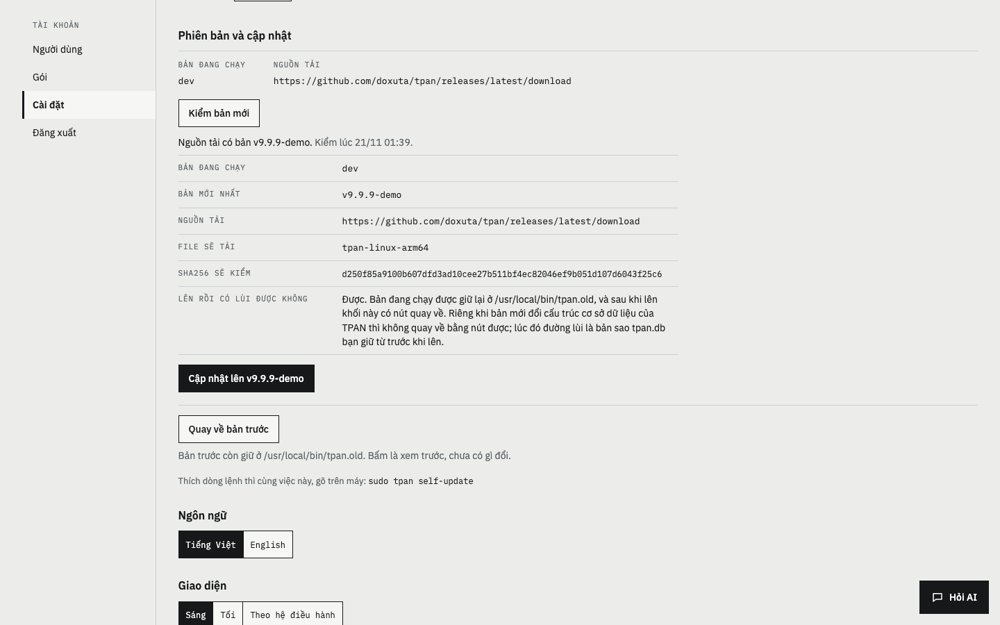
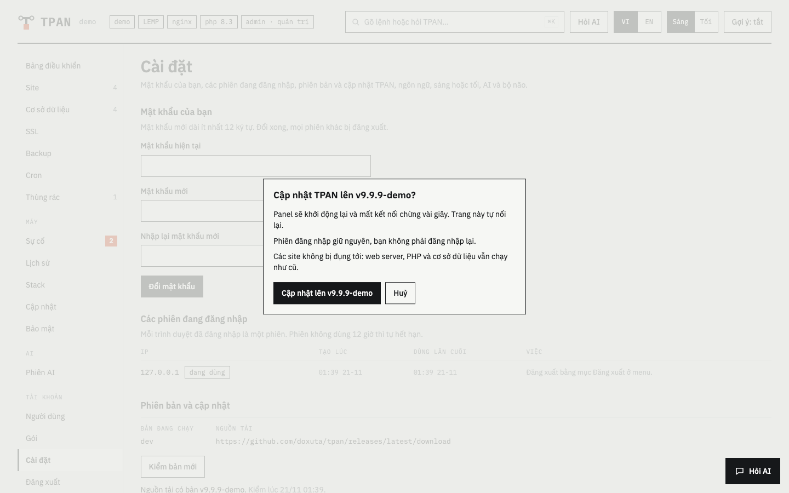
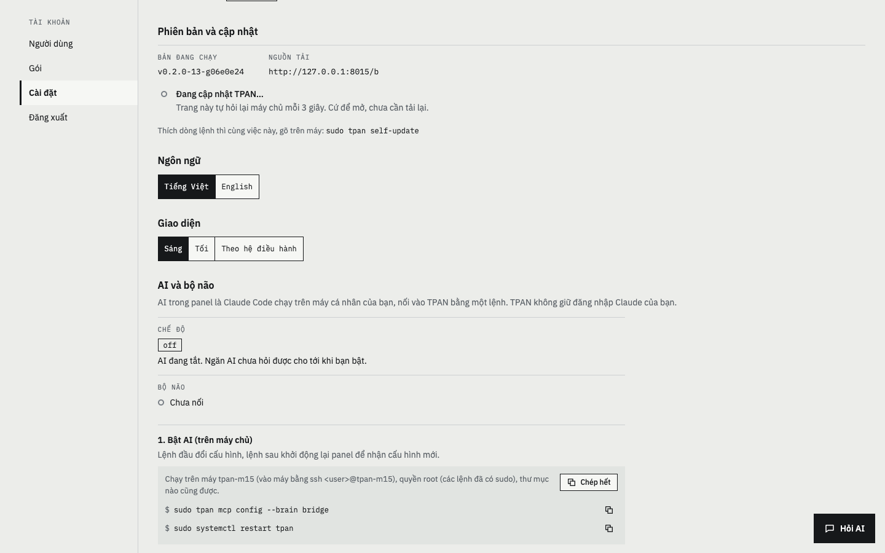
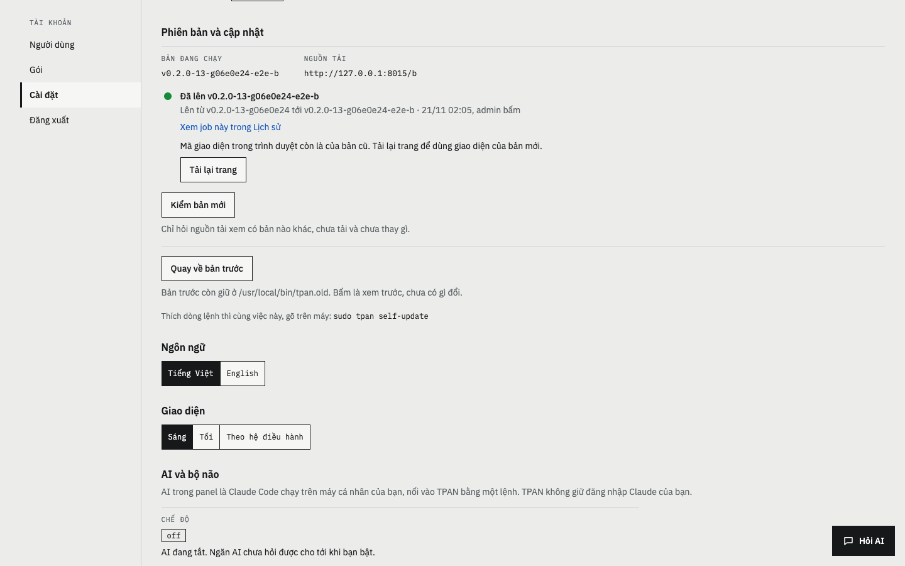

# M15: nút cập nhật TPAN trong panel

Đọc kèm: `11-m11-cai-dat-va-phat-hanh.md` (gói phát hành, `SHA256SUMS`), `12-m12-phien-ban-va-cap-nhat.md` mục 2.10 và 3.12 (`tpan self-update` ở dòng lệnh, `SelfDownload`, `SelfInstall`) cùng đoạn "`rename` và file đang chạy" ở mục 4, `13-m13-nhieu-nguoi-dung.md` (luật route `adminOnly`, phiên "xem như"), `03-m3-giao-dien-va-api.md` (cookie phiên, CSRF, job và SSE), `00-go-can-ban.md` mục 7 (context), `docs/KE-HOACH.md` mục 6.14 (đặc tả đã chốt của mốc này) và phần "Đã chốt khi làm M15" ở mục 6.14 của `docs/KE-HOACH.md` (sổ làm việc: đợt 0 đã thử gì, chỗ khác lời giao việc).

Mốc này sinh ra từ một yêu cầu ngày 21/11/2026, sau khi phát hành v0.2.0: cập nhật TPAN ngay trong panel, không phải SSH vào máy gõ `tpan self-update`. Người review sẽ hỏi quanh bảy câu dưới đây. Bảng này là mục lục của cả file:

| Câu người review hỏi | Trả lời một dòng | Đọc ở |
|---|---|---|
| Vì sao trước đây không có nút? | Bước cuối là `systemctl restart tpan`; systemd dừng mọi tiến trình trong cgroup của dịch vụ, kể cả chính lượt cập nhật. | 2.2, 4.1, 5.1 |
| Panel tự thay file của nó rồi restart, ai chạy tiếp phần còn lại? | Một đơn vị systemd tạm (`tpan-self-update`) nằm ở cgroup riêng. Panel chỉ nhờ systemd khởi nó. | 2.2, 3.6, 3.7, 4.3 |
| Hai người bấm cùng lúc thì sao? | Tên đơn vị cố định: systemd từ chối đơn vị thứ hai cùng tên. Người sau nhận 409 `self_update_running`. | 2.4, 3.6 |
| Tải về file bị sửa thì sao? | sha256 không khớp `SHA256SUMS` thì file bị xoá trước khi được chạy lần nào; file đang chạy còn nguyên. | 2.6, 4.5 |
| Lên rồi lùi được không? | Được, bằng nút "Quay về bản trước" (`tpan.old`). Bản cũ không mở được DB hiện tại thì TPAN từ chối trước khi đổi gì. | 2.7, 2.8, 3.10 |
| Ai cũng bấm được à? | Không. Cả ba route chỉ admin, có chống CSRF. | 2.11, 3.3 |
| Trình duyệt có gửi URL tải không? | Không. Không handler nào đọc thân request; dòng lệnh của đơn vị tạm là hằng. | 2.4, 3.5, 3.6 |

Hai từ dùng suốt file. **Bản A** là bản đang chạy lúc bấm, **bản B** là "bản mới" ở nguồn tải. Trong `M15.log`, A là `v0.2.0-13-g06e0e24` (bản của nhánh lúc chạy e2e), B là `v0.2.0-13-g06e0e24-e2e-b` (cùng mã với A, chỉ khác tên bản, để nút có thứ mà lên). Trong `M15-thu-co-che.log`, A là `v0.2.0-1-g025edb6`, B là `v0.2.0-thu-b`.

## 1. Mốc này làm được gì

- Admin mở màn Cài đặt, khối "Phiên bản và cập nhật", bấm "Kiểm bản mới" để xem nguồn tải đang có bản nào, sẽ tải file gì và sẽ kiểm bằng sha256 nào. Bấm "Cập nhật lên <bản>", xác nhận, rồi để trang mở: panel tự tải, kiểm, thay file chạy, khởi động lại, và trang báo "Đã lên <bản>". Không phải đăng nhập lại.
- Cùng khối đó có nút "Quay về bản trước" khi máy còn giữ `/usr/local/bin/tpan.old`. Nếu bản cũ không mở được cơ sở dữ liệu hiện tại, TPAN từ chối và nói vì sao, chưa đổi file nào.
- Lượt nào hỏng (sai sha256, nguồn tải chết) thì file đang chạy còn nguyên, panel không khởi động lại, và lý do hiện nguyên văn trên màn. Mỗi lượt để lại hai dòng trong nhật ký `audit`: ai bấm, từ IP nào, và `<bản cũ> -> <bản mới>`.
- Dòng phiên bản cuối trang là liên kết tới khối này, có một ô vuông nhỏ khi lần kiểm gần nhất thấy bản mới. Máy chủ tự kiểm tối đa một lần mỗi 6 giờ.
- `tpan self-update` ở dòng lệnh giữ nguyên hành vi. Có một thay đổi áp cho cả dòng lệnh: `--rollback` giờ cũng từ chối khi file cũ không mở được DB.

## 2. Chạy thử

Mọi output dưới đây trích nguyên văn từ bốn nguồn, mình ghi tên file và số dòng ở từng mục:

- `docs/bang-chung/M15-thu-co-che.log`: thử cơ chế ở đợt 0, trước khi viết dòng mã nào của mốc. Script `scripts/e2e-m15/thu-co-che-vm.sh`, chạy trong máy ảo ngày 21/11/2026 lúc 01:07.
- `docs/bang-chung/M15.log`: e2e bước 18, `scripts/e2e-m15.sh`, ngày 21/11/2026 từ 02:02:02 tới 02:04:07, từ máy sạch. Dòng cuối: `TỔNG KẾT: 200 khẳng định đạt, 0 khẳng định không đạt`.
- `docs/bang-chung/M15-giao-dien-that.log` và các ảnh `docs/bang-chung/M15-*.png`: bấm thật bằng Chrome trên panel của máy ảo, ngay sau lần chạy e2e.
- Hai lệnh `go test` mình vừa chạy trên Mac trong phiên viết file này (mục 2.13), cho ba trường hợp mà e2e không dựng được.

Những điều cần biết khi đọc:

- Mình là thợ viết, không được dùng máy ảo trong phiên này. Trừ hai lệnh `go test` ở mục 2.13, không lệnh nào dưới đây do mình vừa chạy. Chỗ nào log không có thì mình ghi "chưa chạy".
- Máy ảo trong log là `tpan-m15` (Multipass, Ubuntu 24.04, arm64), tên nằm trong file `.tpan-vm` của worktree mốc này. Ở repo chính không có file đó thì `scripts/vm.sh` dùng `tpan-test`. `scripts/vm.sh exec X` chạy X trong máy ảo, `scripts/vm.sh root X` chạy bằng quyền root. Mọi lệnh gõ trên Mac, trong thư mục repo.
- Kịch bản che IP và mật khẩu: `<panel>` là địa chỉ panel của máy ảo, `<mac>` là IP của Mac (e2e gọi API bằng `curl` từ Mac, nên "IP của người bấm" trong log là IP của Mac), `<vm>` là IP máy ảo.
- `(phiên: jar.C1)` nghĩa là request mang cookie C1. C1 được tạo lúc máy còn chạy v0.2.0, tức là trước mọi lần cập nhật trong kịch bản.
- Ba thứ sau là **đồ nghề test, chỉ có trong máy ảo**, không phải cách dùng TPAN: nguồn tải là ba thư mục `a`, `b`, `sai` phục vụ bằng `python3 -m http.server` ở `127.0.0.1:8015`; setting `update.self_url` được ghi thẳng vào `tpan.db` bằng `scripts/e2e-m15/db.py` (chưa có lệnh nào của TPAN đặt setting này, mục 5.9); và khoá toàn cục được giữ hộ bằng `flock ... sleep 300` để lượt cập nhật phải chờ, cho e2e kịp bấm lần hai.
- `scripts/e2e-m15/trang-thai.sh` in một "ảnh chụp" mỗi thứ một dòng: `sha-tpan`, `sha-old`, `sha-new` là sha256 của `/usr/local/bin/tpan`, `tpan.old`, `tpan.new`; `MainPID` là số tiến trình của `tpan serve` (đổi nghĩa là panel đã khởi động lại); `don-vi-tam` là trạng thái của đơn vị `tpan-self-update`.

### 2.1 Tự chạy lại

Thử cơ chế (đợt 0). Chuẩn bị và lệnh chép từ đầu `M15-thu-co-che.log` (dòng 4 tới 12), gõ trên Mac:

```bash
make build-linux                          # bản A
make build-linux VERSION=v0.2.0-thu-b     # bản B, cùng mã, chỉ khác số bản
# Xếp mỗi bản vào một thư mục có tpan-linux-arm64 và SHA256SUMS; thư mục "sai"
# là file chạy của B với SHA256SUMS ghi toàn số 0. Chép ba thư mục và
# scripts/e2e-m15/thu-co-che-vm.sh vào /home/ubuntu/thu của máy ảo.
make vm-reset
scripts/vm.sh deploy
scripts/vm.sh root tpan setup --yes
scripts/vm.sh root bash /home/ubuntu/thu/thu-co-che-vm.sh
```

Log không ghi từng lệnh xếp thư mục và chép file, nên phần chú thích ở giữa là lời tả, không phải lệnh đã chạy.

E2E bước 18 (trên Mac). Lệnh đầu của script là `make vm-reset`: máy ảo về snapshot sạch, mất mọi thứ đang có trong đó. Lần chạy trong log mất khoảng hai phút.

```bash
# Cần dist/release/v0.2.0 và dist/release/v0.1.2 (dist/ không vào git;
# đầu scripts/e2e-m15.sh ghi cách tải bằng gh release download).
E2E_LOG=/tmp/M15-thu.log scripts/e2e-m15.sh > /tmp/M15-thu.log 2>&1
tail -1 /tmp/M15-thu.log
```

Mình ghi ra `/tmp/M15-thu.log` để không đè file bằng chứng đã commit. Phần C2 của kịch bản hỏi nguồn tải mặc định trên mạng thật một lần, nên Mac và máy ảo phải ra được mạng.

Bấm thật bằng Chrome (trên Mac, sau khi e2e chạy xong và máy ảo còn nguyên). Chuẩn bị và lệnh chép từ `M15-giao-dien-that.log` dòng 9 tới 13; mình chỉ đổi thư mục ảnh ra `/tmp` để không đè ảnh bằng chứng:

```bash
scripts/vm.sh root systemd-run --unit tpan-e2e-http --collect python3 -m http.server 8015 --bind 127.0.0.1 --directory /home/ubuntu/e2e-m15/rel
scripts/vm.sh root python3 /home/ubuntu/e2e-m15/db.py seturl http://127.0.0.1:8015/b
scripts/vm.sh root tpan admin passwd --yes --json     # in mật khẩu mới đúng một lần
TPAN_PANEL_PASSWORD=<mật khẩu> go run ./scripts/anh-readme -bo m15-that -panel https://<vm>:8443 -out /tmp/m15-anh
```

Cả ba bài trên chỉ chạy với máy ảo test. Không chạy với panel của máy chủ thật.

### 2.2 Hai đoạn quan trọng nhất: cùng một lệnh, hai chỗ đứng

Đây là thí nghiệm quyết định cả thiết kế của mốc. Cùng một lệnh cập nhật, cùng nguồn tải, cùng máy. Khác nhau đúng một điều: tiến trình chạy lệnh đó nằm ở cgroup nào (cgroup là gì: mục 4.1).

Lưu ý: lúc thử, lệnh nội bộ `tpan internal self-update` chưa được viết. Cả hai phần đều chạy `tpan self-update --yes --url ...` của dòng lệnh. Vì vậy cột IP trong `audit` ở đây là `cli`.

**Phần 1: chạy như tiến trình con của `tpan.service`** (`M15-thu-co-che.log` dòng 51 tới 74). Đây là chỗ đứng của mã panel nếu nó tự gọi lệnh cập nhật. Trước đó `MainPID=2295` (dòng 48).

```
######## 1. Chạy self-update như tiến trình con của tpan.service (cách KHÔNG dùng)
Lệnh: (trong cgroup của tpan.service) /usr/local/bin/tpan self-update --yes --url http://127.0.0.1:8015/b
(mã thoát của tiến trình self-update: 1)
--- output của nó:
Bắt đầu job bad529fbf44ddd45
- Tải bản tpan mới vào /usr/local/bin/tpan.new ...
  xong
- Thay /usr/local/bin/tpan bằng /usr/local/bin/tpan.new, giữ bản cũ ở /usr/local/bin/tpan.old ...
  xong
- Khởi động lại tpan ...
  LỖI: bước service.restart:tpan: thực hiện: khởi động lại tpan: chạy systemctl restart tpan: context canceled
    | active
- Hoàn tác: Thay /usr/local/bin/tpan bằng /usr/local/bin/tpan.new, giữ bản cũ ở /usr/local/bin/tpan.old ...
  đã hoàn tác
- Hoàn tác: Tải bản tpan mới vào /usr/local/bin/tpan.new ...
  đã hoàn tác
tpan: ghi nhật ký self.update: context canceled

Job bad529fbf44ddd45: hỏng, đã hoàn tác sạch
Lỗi: bước service.restart:tpan: thực hiện: khởi động lại tpan: chạy systemctl restart tpan: context canceled
--- sau đó:
tpan version: tpan v0.2.0-1-g025edb6 (commit 025edb6, build 2026-11-20T18:04:49Z)
sha256 /usr/local/bin/tpan: 9f15282cdf96679d   .old:    .new: 
MainPID=2349 NRestarts=0 ActiveState=active ActiveEnterTimestamp=Sat 2026-11-21 01:07:42 +07 
```

Đọc từng ý:

- Hai bước đầu (tải, thay file) xong. Tới bước ba, lệnh `systemctl restart tpan` đang chạy thì bị cắt: `context canceled`. Lý do: để restart `tpan.service`, systemd gửi tín hiệu dừng cho mọi tiến trình trong cgroup của dịch vụ đó, và chính lệnh `self-update` đang nằm trong cgroup ấy.
- Thấy lỗi, engine hoàn tác: trả file cũ về chỗ, bỏ file vừa tải. Dòng `sha256` sau đó vẫn là `9f15282cdf96679d` (bản A), không có `.old`, không có `.new`.
- `tpan: ghi nhật ký self.update: context canceled`: dòng `audit` cũng không ghi được. Bảng `audit` ở dòng 80 tới 82 của log không có dòng nào cho job `bad529fbf44ddd45`.
- `MainPID` đổi từ 2295 sang 2349: panel đã khởi động lại thật, nhưng vẫn là bản A. Journal của `tpan.service` (dòng 92 tới 96) có đủ `Stopping`, `Stopped`, `Started`, rồi tiến trình mới in `version=v0.2.0-1-g025edb6`. Một lần gián đoạn vô ích.

**Phần 2: cùng lệnh đó, khởi qua `systemd-run`** (dòng 100 tới 117). `in_tpan` nghĩa là lệnh `systemd-run` được gọi từ bên trong cgroup của `tpan.service`, đúng chỗ panel sẽ gọi.

```
######## 2. Cùng việc đó qua systemd-run, gọi từ BÊN TRONG tpan.service (cách dùng)
tpan version: tpan v0.2.0-1-g025edb6 (commit 025edb6, build 2026-11-20T18:04:49Z)
sha256 /usr/local/bin/tpan: 9f15282cdf96679d   .old:    .new: 
MainPID=2383 NRestarts=0 ActiveState=active ActiveEnterTimestamp=Sat 2026-11-21 01:07:45 +07 

$ in_tpan systemd-run --unit tpan-self-update --collect --description tpan: cap nhat tu panel /usr/local/bin/tpan self-update --yes --url http://127.0.0.1:8015/b
Running as unit: tpan-self-update.service; invocation ID: 6753ef8218ed4c93bfef4d3ae501926e
(mã thoát 0)

$ systemctl is-active tpan-self-update
active
(mã thoát 0)
MainPID=2412 ControlGroup=/system.slice/tpan-self-update.service 
(đơn vị tạm đã chạy xong)
tpan version: tpan v0.2.0-thu-b (commit 025edb6, build 2026-11-20T18:06:17Z)
sha256 /usr/local/bin/tpan: e54822e51099749a   .old: 9f15282cdf96679d   .new: 
MainPID=2440 NRestarts=0 ActiveState=active ActiveEnterTimestamp=Sat 2026-11-21 01:07:47 +07 
MainPID của tpan.service trước: 2383, sau: 2440
```

Journal của đơn vị tạm cho lượt này (dòng 153 tới 167; mình cắt ba dòng: hai dòng kiểm chứng và dòng "Việc tiếp theo") và câu trả lời của panel sau đó (dòng 181 tới 187):

```
Nov 21 01:07:47.464306 tpan-m15 systemd[1]: Started tpan-self-update.service - tpan: cap nhat tu panel.
Nov 21 01:07:47.475482 tpan-m15 tpan[2412]: Bắt đầu job eb4273f4f41ab9ae
Nov 21 01:07:47.476392 tpan-m15 tpan[2412]: - Tải bản tpan mới vào /usr/local/bin/tpan.new ...
Nov 21 01:07:47.521821 tpan-m15 tpan[2412]:   xong
Nov 21 01:07:47.522838 tpan-m15 tpan[2412]: - Thay /usr/local/bin/tpan bằng /usr/local/bin/tpan.new, giữ bản cũ ở /usr/local/bin/tpan.old ...
Nov 21 01:07:47.526588 tpan-m15 tpan[2412]:   xong
Nov 21 01:07:47.535665 tpan-m15 tpan[2412]: - Khởi động lại tpan ...
Nov 21 01:07:47.550343 tpan-m15 tpan[2412]:   xong
Nov 21 01:07:47.558513 tpan-m15 tpan[2412]:   [đạt] File chạy /usr/local/bin/tpan chạy được
Nov 21 01:07:47.561679 tpan-m15 tpan[2412]: Job eb4273f4f41ab9ae: thành công
...
Nov 21 01:07:47.564409 tpan-m15 tpan[2412]: tpan đã đổi: v0.2.0-1-g025edb6 -> v0.2.0-thu-b
...
Nov 21 01:07:47.565645 tpan-m15 systemd[1]: tpan-self-update.service: Deactivated successfully.

$ systemctl is-active tpan-self-update
inactive
(mã thoát 4)

$ curl -ksS -o /dev/null -w panel trả %{http_code}\n https://127.0.0.1:8443/api/v1/health
panel trả 200
(mã thoát 0)
```

Tiến trình `tpan[2412]` vẫn in tiếp sau dòng "Khởi động lại tpan ... xong": nó sống qua lần restart. Lý do nằm ở dòng `ControlGroup=/system.slice/tpan-self-update.service`: nó không ở trong cgroup của `tpan.service`, nên lệnh dừng dịch vụ kia không tới nó.

Đặt hai phần cạnh nhau:

| | Phần 1: con của `tpan.service` | Phần 2: đơn vị tạm |
|---|---|---|
| cgroup của tiến trình cập nhật | của `tpan.service` | `/system.slice/tpan-self-update.service` |
| bước `systemctl restart tpan` | `LỖI: ... context canceled` | `xong` |
| file chạy sau lượt chạy | vẫn bản A (`9f15282cdf96679d`), không có `.old` | bản B (`e54822e51099749a`), `.old` là bản A |
| bảng `jobs` | `rolled_back` (dòng 76) | `succeeded` (dòng 119) |
| bảng `audit` | không có dòng: `ghi nhật ký ...: context canceled` | có dòng `ok`, job `eb4273f4f41ab9ae` (dòng 123) |
| panel | restart một lần (2295 sang 2349), vẫn bản A | restart (2383 sang 2440), lên bản B, trả 200 |

Phần 3 của cùng log (dòng 190 tới 235) thử thêm hai điều mà mã dùng tới. Gọi lần hai khi lượt trước còn chạy:

```
$ systemd-run --unit tpan-self-update --collect true
Failed to start transient service unit: Unit tpan-self-update.service was already loaded or has a fragment file.
(mã thoát 1)
```

Và một lượt lỗi không có `--collect` thì để đơn vị nằm lại, chặn lượt sau cho tới khi có người gõ `reset-failed`:

```
--- lượt lỗi KHÔNG có --collect: đơn vị nằm lại ở trạng thái failed và chặn lượt sau

$ systemd-run --unit tpan-self-update false
Running as unit: tpan-self-update.service; invocation ID: adf409d4a19f44babbe1d9695b9b55b0
(mã thoát 0)

$ systemctl is-active tpan-self-update
failed
(mã thoát 3)

$ systemd-run --unit tpan-self-update --collect true
Failed to start transient service unit: Unit tpan-self-update.service was already loaded or has a fragment file.
(mã thoát 1)

$ systemctl reset-failed tpan-self-update
(mã thoát 0)
```

### 2.3 "Kiểm bản mới" (M15.log dòng 789 tới 845)

Từ đây trở đi là e2e trên mã thật của mốc. Nút "Kiểm bản mới" là `POST /api/v1/self/update?dry_run=1`. Với nguồn tải loopback có bản B (dòng 808 tới 813):

```
[2026-11-21 02:03:29] $ curl -X POST <panel>/api/v1/self/update?dry_run=1   (phiên: jar.C1)
-> HTTP 200
    thân nhận (tối đa 1600 byte): {"version":"v0.2.0-13-g06e0e24","url":"http://127.0.0.1:8015/b","has_old":true,"busy":false,"check":{"current":"v0.2.0-13-g06e0e24","latest":"v0.2.0-13-g06e0e24-e2e-b","url":"http://127.0.0.1:8015/b","asset":"tpan-linux-arm64","sha256":"a694c577c32fa6202cd92f86482d32e14d7ef0c5358d8575c59ef611925a35de","up_to_date":false,"checked_at":"2026-11-21T02:03:29.360078073+07:00"}}
  => ĐẠT: dry_run=1: 200, check.latest là B (v0.2.0-13-g06e0e24-e2e-b), check.current là A
  => ĐẠT: check.sha256 khớp SHA256SUMS của b
  => ĐẠT: up_to_date false, check.asset là tpan-linux-arm64, check.url là http://127.0.0.1:8015/b, không có check.error
```

`check.sha256` là số mà file tải về sẽ phải khớp. `check.latest` đọc từ file `VERSION` ở nguồn tải. Ba khẳng định nữa của cùng phần (dòng 823, 828, 845) cho thấy đệm 6 giờ và việc "chỉ đọc":

```
  => ĐẠT: dry_run=1&auto=1: trả cùng checked_at (không kiểm lại)
  => ĐẠT: dry_run=1 không auto (người bấm nút): kiểm lại, checked_at mới
  => ĐẠT: kiểm bản mới không tải file chạy, không đổi gì: file chạy vẫn là A, không có tpan.new, chưa có update.self_last
```

Trước đó, phần C2 hỏi nguồn tải mặc định trên mạng thật, nơi đang có bản v0.2.0 phát hành trước M15 (dòng 798):

```
  => ĐẠT: check.latest rỗng (bản phát hành cũ chưa có file VERSION), up_to_date false, asset tpan-linux-arm64
```

Đó là giới hạn thứ ba ở mục 5.9: với bản phát hành cũ, màn chỉ nói được "có bản khác".

### 2.4 Bấm cập nhật, và bấm lần hai (M15.log dòng 993 tới 1055)

Để kịp bấm lần hai, e2e giữ khoá toàn cục `/run/tpan/tpan.lock` trước. Lượt cập nhật khởi được nhưng phải đứng chờ khoá (mục 4.8). Lần bấm thứ nhất cố tình gửi kèm một thân JSON lạ:

```
[2026-11-21 02:03:33] $ curl -X POST <panel>/api/v1/self/update   (phiên: jar.C1)
    thân gửi: {"url":"http://evil.example.com/x","version":"v9"}
-> HTTP 202
    thân nhận (tối đa 1600 byte): {"run":{"action":"update","status":"running","from":"v0.2.0-13-g06e0e24","actor":"admin","ip":"<mac>","started":"2026-11-21T02:03:33.922583521+07:00"}}
  => ĐẠT: POST /self/update (kèm thân JSON lạ): 202
  => ĐẠT: run.status running, run.from là A, run.actor admin, run.action update
```

202 nghĩa là "đã nhận, đang làm", không phải "đã xong". Câu trả lời mang lượt chạy vừa ghi. Hỏi lại trạng thái ngay sau đó:

```
[2026-11-21 02:03:33] $ curl -X GET <panel>/api/v1/self   (phiên: jar.C1)
-> HTTP 200
    thân nhận (tối đa 1600 byte): {"version":"v0.2.0-13-g06e0e24","url":"http://127.0.0.1:8015/b","has_old":true,"busy":true,"last":{"action":"update","status":"running","from":"v0.2.0-13-g06e0e24","actor":"admin","ip":"<mac>","started":"2026-11-21T02:03:33.922583521+07:00"},"check":{"current":"v0.2.0-13-g06e0e24","latest":"v0.2.0-13-g06e0e24-e2e-b","url":"http://127.0.0.1:8015/b","asset":"tpan-linux-arm64","sha256":"a694c577c32fa6202cd92f86482d32e14d7ef0c5358d8575c59ef611925a35de","up_to_date":false,"checked_at":"2026-11-21T02:03:30.608927807+07:00"}}
  => ĐẠT: ngay sau đó GET /self: busy true, last.status running
```

`busy` là "đơn vị tạm đang chạy" (hỏi systemd), `last.status` là thứ ghi trong settings. Bấm lần hai trong lúc đó:

```
[2026-11-21 02:03:34] $ curl -X POST <panel>/api/v1/self/update   (phiên: jar.C1)
-> HTTP 409
    thân nhận (tối đa 1600 byte): {"error":{"code":"self_update_running","message":{"vi":"một lượt cập nhật hoặc quay về tpan đang chạy (đơn vị tpan-self-update); đợi nó xong rồi thử lại. Xem nó đang làm gì: journalctl -u tpan-self-update","en":"a tpan update or rollback is already running (unit tpan-self-update); wait for it to finish, then try again. To see what it is doing: journalctl -u tpan-self-update"}}}
  => ĐẠT: POST /self/update lần hai: 409 self_update_running
```

Nút "Quay về" trong lúc đó cũng nhận đúng mã này (dòng 1021 tới 1024). Rồi e2e hỏi systemd xem đơn vị tạm đang chạy lệnh gì:

```
[2026-11-21 02:03:34] $ scripts/vm.sh exec systemctl show tpan-self-update -p ExecStart -p Description -p ControlGroup
ExecStart={ path=/usr/local/bin/tpan ; argv[]=/usr/local/bin/tpan internal self-update ; ignore_errors=no ; start_time=[Sat 2026-11-21 02:03:33 +07] ; stop_time=[n/a] ; pid=15804 ; code=(null) ; status=0/0 }
ControlGroup=/system.slice/tpan-self-update.service
Description=tpan: cap nhat tu panel
[2026-11-21 02:03:34] (mã thoát 0)
  => ĐẠT: dòng lệnh của đơn vị tạm đúng là /usr/local/bin/tpan internal self-update
  => ĐẠT: đơn vị tạm nằm ở cgroup riêng (/system.slice/tpan-self-update.service)
  => ĐẠT: dòng lệnh và mô tả không chứa evil.example.com, tên user hay IP nào
```

`argv[]` chỉ có ba chữ: `/usr/local/bin/tpan internal self-update`. URL lạ trong thân request không đi tới đâu cả. Đây là câu trả lời cho "trình duyệt có gửi URL tải không".

### 2.5 Nhả khoá: A lên B, panel khởi động lại (M15.log dòng 1058 tới 1146)

E2E nhả khoá rồi hỏi `GET /api/v1/session` liên tục bằng chính cookie C1, như giao diện làm (dòng 1063 tới 1066):

```
[2026-11-21 02:03:34] (nền) hỏi GET <panel>/api/v1/session bằng cookie C1, 0,05 giây một lần, tới khi version là v0.2.0-13-g06e0e24-e2e-b:
    4 lần hỏi trong 262 ms; 0 lần hỏng kết nối (panel đang restart); version ở lần hỏi cuối: v0.2.0-13-g06e0e24-e2e-b
    không lần hỏi nào hỏng: lần restart lọt giữa hai lần hỏi (ngắn hơn khoảng cách hỏi)
  => ĐẠT: GET /session trả version B (v0.2.0-13-g06e0e24-e2e-b) trong vòng 60 giây
```

Ảnh chụp máy sau đó (dòng 1068 tới 1090; mình cắt các dòng không đổi):

```
[2026-11-21 02:03:34] $ scripts/vm.sh root bash /home/ubuntu/e2e-m15/trang-thai.sh cho 60
cho-don-vi=xong sau 0 giây
luc=2026-11-21 02:03:34
phien-ban=tpan v0.2.0-13-g06e0e24-e2e-b (commit 06e0e24, build 2026-11-20T19:02:02Z)
sha-tpan=a694c577c32fa6202cd92f86482d32e14d7ef0c5358d8575c59ef611925a35de
sha-old=66ee771495a07c36e8d0594afb04e1fb4c8523b200b361fbaa2465a81e245ae6
sha-new=(không có)
MainPID=16078
ActiveState=active
NRestarts=0
don-vi-tam=inactive
khong-active-ms=7
tat-den-nghe-ms=14
update.self_url=http://127.0.0.1:8015/b
update.self_last={"action":"update","status":"ok","from":"v0.2.0-13-g06e0e24","to":"v0.2.0-13-g06e0e24-e2e-b","job_id":"22c7b7e97ab64f03","actor":"admin","ip":"<mac>","started":"2026-11-21T02:03:33.922583521+07:00","finished":"2026-11-21T02:03:34.814686554+07:00"}
[2026-11-21 02:03:35] (mã thoát 0)
...
  => ĐẠT: MainPID của tpan.service đổi (14793 -> 16078), dịch vụ active
  => ĐẠT: tpan version là B
  => ĐẠT: file chạy là file của b, tpan.old là file của A (sha256)
  => ĐẠT: systemctl is-active tpan-self-update in inactive (đơn vị đã tự dọn)
  => ĐẠT: setting update.self_url vẫn là http://127.0.0.1:8015/b (thân request không đổi được nguồn tải)
```

`sha-tpan` giờ bằng đúng `check.sha256` của mục 2.3. `sha-old` là file của bản A. `update.self_last` đã đổi từ `running` sang `ok`, có `to`, `job_id`, `finished`. Màn đọc lại thứ này qua `GET /api/v1/self` (dòng 1102 tới 1108):

```
[2026-11-21 02:03:35] $ curl -X GET <panel>/api/v1/self   (phiên: jar.C1)
-> HTTP 200
    thân nhận (tối đa 1600 byte): {"version":"v0.2.0-13-g06e0e24-e2e-b","url":"http://127.0.0.1:8015/b","has_old":true,"busy":false,"last":{"action":"update","status":"ok","from":"v0.2.0-13-g06e0e24","to":"v0.2.0-13-g06e0e24-e2e-b","job_id":"22c7b7e97ab64f03","actor":"admin","ip":"<mac>","started":"2026-11-21T02:03:33.922583521+07:00","finished":"2026-11-21T02:03:34.814686554+07:00"}}
  => ĐẠT: GET /self: last.action update, status ok, from A, to B
  => ĐẠT: last.actor admin, last.ip không phải cli, có job_id, có finished
  => ĐẠT: last.ip là IP của máy đã bấm (ở đây là Mac, đã che trong log)
  => ĐẠT: busy false; version B; has_old true; check vắng (panel vừa restart nên quên lần kiểm)
```

Nhật ký `audit` (`M15.log` dòng 1110 tới 1120). Cột theo thứ tự: số thứ tự của dòng trong bảng, IP, người bấm, thao tác, đối tượng, kết quả, job. Dưới đây "dòng số 8" nghĩa là dòng `audit` có số thứ tự 8, không phải dòng 8 của file log:

```
audit|id|ip|actor|action|target|result|job_id
audit|5|cli||self.update|http://127.0.0.1:8015/a|ok|c4f34f65cf7839dd
audit|8|<mac>|admin|self.update|v0.2.0-13-g06e0e24|started|
audit|9|<mac>|admin|self.update|v0.2.0-13-g06e0e24|self_update_running|
audit|10|<mac>|admin|self.rollback|v0.2.0-13-g06e0e24|self_update_running|
audit|11|<mac>|admin|self.update|v0.2.0-13-g06e0e24 -> v0.2.0-13-g06e0e24-e2e-b|ok|22c7b7e97ab64f03
```

Một lượt bấm thành công để lại hai dòng: dòng số 8 (`started`, do panel ghi lúc bấm) và dòng số 11 (`A -> B`, `ok`, do đơn vị tạm ghi lúc xong, cùng `job_id` với `last`). Dòng số 9 và 10 là hai lần bấm bị từ chối ở mục 2.4. Dòng số 5 là lần lên bằng dòng lệnh ở phần B của kịch bản: IP là `cli`, không có người bấm.

Journal của đơn vị tạm (dòng 1129 tới 1143):

```
[2026-11-21 02:03:35] $ scripts/vm.sh root journalctl -u tpan-self-update --no-pager -o short-precise --since 2026-11-21 02:03:32
Nov 21 02:03:33.936743 tpan-m15 systemd[1]: Started tpan-self-update.service - tpan: cap nhat tu panel.
Nov 21 02:03:34.723674 tpan-m15 tpan[15804]: Bắt đầu job 22c7b7e97ab64f03
Nov 21 02:03:34.724420 tpan-m15 tpan[15804]: - Tải bản tpan mới vào /usr/local/bin/tpan.new ...
Nov 21 02:03:34.774516 tpan-m15 tpan[15804]:   xong
Nov 21 02:03:34.775273 tpan-m15 tpan[15804]: - Thay /usr/local/bin/tpan bằng /usr/local/bin/tpan.new, giữ bản cũ ở /usr/local/bin/tpan.old ...
Nov 21 02:03:34.783373 tpan-m15 tpan[15804]:   xong
Nov 21 02:03:34.785696 tpan-m15 tpan[15804]: - Khởi động lại tpan ...
Nov 21 02:03:34.802902 tpan-m15 tpan[15804]:   xong
Nov 21 02:03:34.810667 tpan-m15 tpan[15804]:   [đạt] File chạy /usr/local/bin/tpan chạy được
Nov 21 02:03:34.816237 tpan-m15 tpan[15804]: Job 22c7b7e97ab64f03: thành công
Nov 21 02:03:34.816237 tpan-m15 tpan[15804]: Kiểm chứng:
Nov 21 02:03:34.816237 tpan-m15 tpan[15804]:   [đạt] File chạy /usr/local/bin/tpan chạy được: tpan v0.2.0-13-g06e0e24-e2e-b (commit 06e0e24, build 2026-11-20T19:02:02Z)
Nov 21 02:03:34.816237 tpan-m15 tpan[15804]: tpan đã đổi: v0.2.0-13-g06e0e24 -> v0.2.0-13-g06e0e24-e2e-b
Nov 21 02:03:34.818319 tpan-m15 systemd[1]: tpan-self-update.service: Deactivated successfully.
```

Đơn vị khởi lúc 02:03:33.936 nhưng job bắt đầu lúc 02:03:34.723: gần 0,8 giây ở giữa là lúc nó đứng chờ khoá mà e2e giữ. Từ lúc có khoá, cả lượt (tải, thay, restart, kiểm) mất chưa tới 0,1 giây, vì nguồn tải nằm ngay trên máy. Journal này còn đọc được sau khi đơn vị đã bị dọn.

### 2.6 Nguồn tải có `SHA256SUMS` sai (M15.log dòng 1151 tới 1242)

Thư mục `sai` chứa file chạy của B, nhưng `SHA256SUMS` ghi 64 số 0. Máy đang ở bản B. Bấm cập nhật vẫn nhận 202 (lượt chạy khởi được), rồi kết quả nằm ở settings (dòng 1199 tới 1204):

```
update.self_last={"action":"update","status":"failed","from":"v0.2.0-13-g06e0e24-e2e-b","to":"v0.2.0-13-g06e0e24-e2e-b","error":"bước self.download:/usr/local/bin/tpan.new: thực hiện: tpan-linux-arm64 tải về có sha256 a694c577c32fa6202cd92f86482d32e14d7ef0c5358d8575c59ef611925a35de, SHA256SUMS ghi 0000000000000000000000000000000000000000000000000000000000000000; đã bỏ file /usr/local/bin/tpan.new","job_id":"d9097500231928fd","actor":"admin","ip":"<mac>","started":"2026-11-21T02:03:36.182143751+07:00","finished":"2026-11-21T02:03:36.236912526+07:00"}
[2026-11-21 02:03:36] (mã thoát 0)
  => ĐẠT: đơn vị tạm đã chạy xong (xong sau 0 giây)
  => ĐẠT: sha256 của /usr/local/bin/tpan không đổi (vẫn là b), tpan version vẫn B
  => ĐẠT: MainPID không đổi (panel không restart), dịch vụ active
  => ĐẠT: không còn /usr/local/bin/tpan.new (file tải về sai sha256 đã bị bỏ); tpan.old vẫn là A
```

`last.error` là câu màn hiện dưới nhãn "LỖI CỦA JOB". Log in riêng nó (dòng 1209):

```
    last.error nguyên văn: bước self.download:/usr/local/bin/tpan.new: thực hiện: tpan-linux-arm64 tải về có sha256 a694c577c32fa6202cd92f86482d32e14d7ef0c5358d8575c59ef611925a35de, SHA256SUMS ghi 0000000000000000000000000000000000000000000000000000000000000000; đã bỏ file /usr/local/bin/tpan.new
```

Câu lỗi có cả hai số: số của file tải về và số ghi trong `SHA256SUMS`. Journal của đơn vị tạm (dòng 1226 tới 1234) cho thấy lượt chạy dừng ngay ở bước một, không có bước thay file và không có bước khởi động lại:

```
Nov 21 02:03:36.192494 tpan-m15 systemd[1]: Started tpan-self-update.service - tpan: cap nhat tu panel.
Nov 21 02:03:36.198432 tpan-m15 tpan[16552]: Bắt đầu job d9097500231928fd
Nov 21 02:03:36.199501 tpan-m15 tpan[16552]: - Tải bản tpan mới vào /usr/local/bin/tpan.new ...
Nov 21 02:03:36.232515 tpan-m15 tpan[16552]:   LỖI: bước self.download:/usr/local/bin/tpan.new: thực hiện: tpan-linux-arm64 tải về có sha256 a694c577c32fa6202cd92f86482d32e14d7ef0c5358d8575c59ef611925a35de, SHA256SUMS ghi 0000000000000000000000000000000000000000000000000000000000000000; đã bỏ file /usr/local/bin/tpan.new
Nov 21 02:03:36.232515 tpan-m15 tpan[16552]:     | 0000000000000000000000000000000000000000000000000000000000000000  tpan-linux-arm64
Nov 21 02:03:36.238490 tpan-m15 tpan[16552]: Job d9097500231928fd: hỏng, đã hoàn tác sạch
Nov 21 02:03:36.238490 tpan-m15 tpan[16552]: Lỗi: bước self.download:/usr/local/bin/tpan.new: thực hiện: tpan-linux-arm64 tải về có sha256 a694c577c32fa6202cd92f86482d32e14d7ef0c5358d8575c59ef611925a35de, SHA256SUMS ghi 0000000000000000000000000000000000000000000000000000000000000000; đã bỏ file /usr/local/bin/tpan.new
Nov 21 02:03:36.239449 tpan-m15 systemd[1]: tpan-self-update.service: Main process exited, code=exited, status=1/FAILURE
Nov 21 02:03:36.239503 tpan-m15 systemd[1]: tpan-self-update.service: Failed with result 'exit-code'.
```

Đơn vị kết thúc ở `Failed`, vậy mà lượt bấm kế tiếp vẫn nhận 202: đó là tác dụng của `--collect`.

Hai chỗ dễ nhầm khi đọc `audit` của lượt này (dòng 1220, 1221):

```
audit|12|<mac>|admin|self.update|v0.2.0-13-g06e0e24-e2e-b|started|
audit|13|<mac>|admin|self.update|v0.2.0-13-g06e0e24-e2e-b -> v0.2.0-13-g06e0e24-e2e-b|rolled_back|d9097500231928fd
```

Kết quả trong `audit` là `rolled_back` (trạng thái của job), còn trong settings là `failed` (trạng thái của lượt chạy). Hai chữ, một sự việc. Đối tượng là `B -> B` vì sau lượt hỏng, file chạy vẫn là B.

Cùng phần D còn thử nguồn tải chết (cổng 8016 không có gì nghe). "Kiểm bản mới" vẫn trả 200, lý do nằm ở `check.error` (dòng 1256):

```
    check.error nguyên văn: Không hỏi được nguồn tải: hỏi gốc tải bản phát hành: tải SHA256SUMS từ http://127.0.0.1:8016/khong-co: curl -fsSL --max-time 15 --proto-redir =https http://127.0.0.1:8016/khong-co/SHA256SUMS: mã thoát 7: curl: (7) Failed to connect to 127.0.0.1 port 8016 after 0 ms: Couldn't connect to server
```

### 2.7 Quay về bản trước (M15.log dòng 1407 tới 1515)

Máy đang ở B, `tpan.old` là A. Bấm "Quay về bản trước" là hai lời gọi: bản xem trước cho hộp xác nhận, rồi chạy thật.

```
[2026-11-21 02:03:39] $ curl -X POST <panel>/api/v1/self/rollback?dry_run=1   (phiên: jar.C1)
-> HTTP 200
    thân nhận (tối đa 1600 byte): {"current":"v0.2.0-13-g06e0e24-e2e-b","old":"v0.2.0-13-g06e0e24"}
  => ĐẠT: POST /self/rollback?dry_run=1: 200 {current: B, old: A}
  => ĐẠT: current là B, old là A

[2026-11-21 02:03:39] $ curl -X POST <panel>/api/v1/self/rollback   (phiên: jar.C1)
-> HTTP 202
    thân nhận (tối đa 1600 byte): {"run":{"action":"rollback","status":"running","from":"v0.2.0-13-g06e0e24-e2e-b","actor":"admin","ip":"<mac>","started":"2026-11-21T02:03:39.144504095+07:00"}}
```

Kết quả (dòng 1461 tới 1467; mình cắt các dòng ở giữa):

```
update.self_last={"action":"rollback","status":"ok","from":"v0.2.0-13-g06e0e24-e2e-b","to":"v0.2.0-13-g06e0e24","job_id":"577ccdf5639ea10c","actor":"admin","ip":"<mac>","started":"2026-11-21T02:03:39.144504095+07:00","finished":"2026-11-21T02:03:39.22809938+07:00"}
...
  => ĐẠT: tpan version là A, file chạy là file của A (sha256)
  => ĐẠT: MainPID đổi (16078 -> 17608), dịch vụ active
  => ĐẠT: không còn tpan.old; bản vừa bị thay ra (B) nằm ở tpan.new
```

Quay về là phép đổi ngược của cập nhật: `tpan.old` thành `tpan`, còn bản vừa bị thay ra thành `tpan.new`. Vì vậy sau khi quay về, máy không còn `tpan.old`, khối không còn nút "Quay về", và bấm lần nữa bằng API thì bị từ chối (dòng 1505 tới 1508):

```
[2026-11-21 02:03:39] $ curl -X POST <panel>/api/v1/self/rollback   (phiên: jar.C1)
-> HTTP 409
    thân nhận (tối đa 1600 byte): {"error":{"code":"self_no_old","message":{"vi":"không có /usr/local/bin/tpan.old để quay về (chưa từng self-update, hoặc đã quay về rồi)","en":"there is no /usr/local/bin/tpan.old to go back to (no self-update yet, or already rolled back)"}}}
  => ĐẠT: POST /self/rollback lần nữa: 409 self_no_old
```

### 2.8 Từ chối quay về khi bản cũ không mở được DB (M15.log dòng 1518 tới 1612)

E2E đặt file chạy của v0.1.2 vào chỗ `tpan.old`. v0.1.2 chỉ biết cấu trúc DB tới bản 900; DB của máy đang ở bản 1400.

```
[2026-11-21 02:03:40] $ scripts/vm.sh root /usr/local/bin/tpan.old version
tpan v0.1.2 (commit d6675d0, build 2026-11-20T09:01:34Z)
[2026-11-21 02:03:40] (mã thoát 0)
```

Ngay bản xem trước đã bị từ chối, nên hộp xác nhận không mở ra để mời bấm một thứ chắc chắn hỏng (dòng 1548, 1549):

```
  => ĐẠT: POST /self/rollback?dry_run=1: 409 self_rollback_db
    lời từ chối nguyên văn: bản trước (/usr/local/bin/tpan.old) không mở được /var/lib/tpan/tpan.db hiện tại, thường vì bản đang chạy đã nâng cấu trúc DB. Quay về lúc này thì dịch vụ tpan khởi động lại liên tục, nên chưa đổi gì. Bản trước báo: tpan: mở DB /var/lib/tpan/tpan.db: migration DB /var/lib/tpan/tpan.db: DB ở bản 1400, tpan này chỉ biết tới bản 900: hãy dùng tpan mới hơn. Hai đường còn lại: chép lại bản sao /var/lib/tpan/tpan.db có từ trước khi nâng rồi mới quay về, hoặc ở lại bản này
```

Đoạn "Bản trước báo: ..." là câu của chính file v0.1.2 in ra, TPAN chép lại. Dòng lệnh cũng từ chối y như vậy (dòng 1579 tới 1583):

```
[2026-11-21 02:03:40] $ scripts/vm.sh root tpan self-update --rollback --yes
Từ chối: bản trước (/usr/local/bin/tpan.old) không mở được /var/lib/tpan/tpan.db hiện tại, thường vì bản đang chạy đã nâng cấu trúc DB. Quay về lúc này thì dịch vụ tpan khởi động lại liên tục, nên chưa đổi gì. Bản trước báo: tpan: mở DB /var/lib/tpan/tpan.db: migration DB /var/lib/tpan/tpan.db: DB ở bản 1400, tpan này chỉ biết tới bản 900: hãy dùng tpan mới hơn. Hai đường còn lại: chép lại bản sao /var/lib/tpan/tpan.db có từ trước khi nâng rồi mới quay về, hoặc ở lại bản này
[2026-11-21 02:03:41] (mã thoát 1)
  => ĐẠT: CLI tpan self-update --rollback --yes: thoát khác 0
  => ĐẠT: CLI in lời từ chối có câu của file cũ
```

Và không có gì đổi (dòng 1605, 1606):

```
  => ĐẠT: file chạy, tpan.old, MainPID, phiên bản, update.self_last không đổi
  => ĐẠT: đơn vị tạm không chạy; tpan.service active
```

### 2.9 Lượt chạy bị giết giữa chừng (M15.log dòng 1615 tới 1733)

E2E lại giữ khoá cho lượt chạy đứng chờ, rồi giết tiến trình của đơn vị tạm bằng `KILL` (tín hiệu không bắt được, không kịp ghi gì):

```
[2026-11-21 02:03:43] $ scripts/vm.sh root systemctl kill --kill-whom=main -s KILL tpan-self-update
[2026-11-21 02:03:43] (mã thoát 0)
  => ĐẠT: systemctl kill --kill-whom=main -s KILL tpan-self-update thoát 0 (KILL dọn được đơn vị, không cần systemctl stop)

[2026-11-21 02:03:45] $ scripts/vm.sh exec systemctl is-active tpan-self-update
inactive
[2026-11-21 02:03:45] (mã thoát 4)
  => ĐẠT: sau KILL đơn vị tạm không còn chạy (--collect dọn cả đơn vị bị giết)
```

Settings vẫn ghi `running`, vì không ai kịp ghi kết quả. API trả gì? Ngay sau đó, rồi 16 giây sau (dòng 1665 tới 1675):

```
[2026-11-21 02:03:45] $ curl -X GET <panel>/api/v1/self   (phiên: jar.C1)
-> HTTP 200
    thân nhận (tối đa 1600 byte): {"version":"v0.2.0-13-g06e0e24","url":"http://127.0.0.1:8015/b","has_old":false,"busy":false,"last":{"action":"update","status":"running","from":"v0.2.0-13-g06e0e24","actor":"admin","ip":"<mac>","started":"2026-11-21T02:03:42.877769318+07:00"}}
  => ĐẠT: ngay sau khi bị giết (chưa quá 15 giây): busy false, last.status còn running

[2026-11-21 02:03:45] (chờ 16 giây: quá hạn selfInterruptAfter 15 giây)

[2026-11-21 02:04:01] $ curl -X GET <panel>/api/v1/self   (phiên: jar.C1)
-> HTTP 200
    thân nhận (tối đa 1600 byte): {"version":"v0.2.0-13-g06e0e24","url":"http://127.0.0.1:8015/b","has_old":false,"busy":false,"last":{"action":"update","status":"interrupted","from":"v0.2.0-13-g06e0e24","actor":"admin","ip":"<mac>","started":"2026-11-21T02:03:42.877769318+07:00"}}
  => ĐẠT: sau 16 giây: busy false, last.status là interrupted
```

`interrupted` chỉ có trong câu trả lời của API; settings vẫn giữ dấu gốc (dòng 1693):

```
  => ĐẠT: settings vẫn giữ dấu gốc (status running): interrupted chỉ có trong câu trả lời của API
```

Lượt bấm kế tiếp chạy bình thường, không bị đơn vị cũ chặn (dòng 1698 tới 1701), và kết thúc `ok`. Trong bảng `audit` cuối kịch bản, lượt bị giết để lại đúng một dòng `started` (dòng số 24) mà không có dòng kết quả đi kèm; dòng số 25 và 26 là lượt bình thường sau đó:

```
audit|24|<mac>|admin|self.update|v0.2.0-13-g06e0e24|started|
audit|25|<mac>|admin|self.update|v0.2.0-13-g06e0e24|started|
audit|26|<mac>|admin|self.update|v0.2.0-13-g06e0e24 -> v0.2.0-13-g06e0e24-e2e-b|ok|3fe9350eb3bd1b70
```

### 2.10 Panel gián đoạn bao lâu

`trang-thai.sh` đo mỗi lần restart bằng hai cách. `khong-active-ms`: khoảng `tpan.service` rời trạng thái `active` rồi `active` lại, theo đồng hồ của systemd. `tat-den-nghe-ms`: từ dòng `Stopping tpan.service` tới dòng `tpan đang chạy` của tiến trình mới trong journal, tức là tới lúc cổng 8443 nhận kết nối trở lại.

| Lượt | `tpan.service` không active | Tới lúc tiến trình mới mở cổng | `M15.log` |
|---|---|---|---|
| Phần B: dòng lệnh của v0.2.0, v0.2.0 lên A | 13 ms | 21 ms | dòng 680, 681 |
| Phần C6: nút, A lên B | 7 ms | 14 ms | dòng 1085 |
| Phần E: nút quay về, B về A | 5 ms | 11 ms | dòng 1464 |
| Phần G: nút, A lên B | 4 ms | 15 ms | dòng 1725 |

Ba lượt bấm nút: 4 tới 7 ms không active, 11 tới 15 ms tính tới lúc mở cổng. Dòng ghi nhận nguyên văn của lượt C6:

```
  -- GHI NHẬN: gián đoạn của lần restart này: tpan.service không active 7 ms (ActiveExit -> ActiveEnter của systemd); từ lúc systemd bắt đầu dừng tới lúc tiến trình mới mở cổng nghe 14 ms (journal); nhìn từ trình duyệt: 0 lần hỏi hỏng, khoảng 0 ms
```

Các số này đo trên máy ảo gần như trống (một site, không job nào khác). Trên máy thật có thể dài hơn; chưa đo.

### 2.11 Ai bấm được (M15.log dòng 848 tới 990)

User thường `khach_m15`, rồi không cookie, rồi admin nhưng request mang dấu "đến từ trang khác":

```
[2026-11-21 02:03:31] $ curl -X GET <panel>/api/v1/self   (phiên: jar.user-thuong)
-> HTTP 403
    thân nhận (tối đa 1600 byte): {"error":{"code":"forbidden","message":{"vi":"Chỉ quản trị viên được làm việc này.","en":"Only an administrator can do this."}}}
  => ĐẠT: user thường: GET /self 403 forbidden
```

```
[2026-11-21 02:03:31] $ curl -X POST <panel>/api/v1/self/update   (phiên: jar.khong-cookie)
-> HTTP 401
    thân nhận (tối đa 1600 byte): {"error":{"code":"unauthorized","message":{"vi":"Chưa đăng nhập hoặc phiên đã hết hạn.","en":"Not logged in, or the session has expired."}}}
  => ĐẠT: không cookie: POST /self/update 401 unauthorized
```

```
[2026-11-21 02:03:32] $ curl -X POST <panel>/api/v1/self/update   (phiên: jar.C1)   [Sec-Fetch-Site: cross-site; Origin: https://evil.example.com]
-> HTTP 403
    thân nhận (tối đa 1600 byte): {"error":{"code":"csrf","message":{"vi":"Yêu cầu đến từ một trang khác nên bị chặn (chống CSRF). Hãy thao tác từ chính giao diện tpan.","en":"The request came from another site and was blocked (CSRF protection). Use the tpan interface itself."}}}
  => ĐẠT: admin, Sec-Fetch-Site: cross-site: POST /self/update bị chặn 403 csrf
```

Sau cả loạt request bị từ chối, không lượt nào được khởi (dòng 983 tới 990):

```
  => ĐẠT: sau cả loạt: file chạy, tpan.old, MainPID, update.self_url, update.self_last không đổi
  => ĐẠT: đơn vị tạm tpan-self-update không chạy
```

### 2.12 Bấm thật bằng Chrome (M15-giao-dien-that.log)

E2E gọi API bằng `curl`, nên nó không chạy dòng mã nào của giao diện. Bài này mở panel của máy ảo trong Chrome không giao diện, bấm đúng các nút người dùng bấm, và nhìn trang mỗi 100 ms trong lúc panel khởi động lại. Output (dòng 17 tới 28):

```
bản đang chạy lúc đầu: v0.2.0-13-g06e0e24
docs/bang-chung/M15-that-1-xem-truoc.png  110 KB
docs/bang-chung/M15-that-2-dang-cap-nhat.png  91 KB
từ lúc bấm tới lúc khối báo "Đã lên": 3.1 giây
cập nhật: trong lúc chờ, trang đã thấy {"paths":["/settings"],"restarting":false,"updating":true,"loginSeen":false}
bản đang chạy sau khi cập nhật: v0.2.0-13-g06e0e24-e2e-b (phiên đăng nhập cũ còn dùng được: /api/v1/session trả lời có version)
docs/bang-chung/M15-that-3-da-len.png  93 KB
dòng cuối trang sau khi lên: "TPAN v0.2.0-13-g06e0e24-e2e-b"
docs/bang-chung/M15-that-4-hoi-quay-ve.png  126 KB
từ lúc bấm tới lúc khối báo "Đã quay về": 3.2 giây
cập nhật: xem dòng trên; quay về: trong lúc chờ, trang đã thấy {"paths":["/settings"],"restarting":false,"updating":true,"loginSeen":false}
bản đang chạy sau khi quay về: v0.2.0-13-g06e0e24
```

Đọc kết quả:

- `"paths":["/settings"]` và `"loginSeen":false`: trang ở nguyên màn Cài đặt suốt lượt chạy, không lần nào văng về trang đăng nhập.
- 3,1 giây từ lúc bấm tới lúc báo "Đã lên" là một nhịp hỏi lại của trang (3 giây), không phải thời gian cập nhật. Lượt cập nhật thật mất chưa tới một giây (mục 2.5).
- `"restarting":false`: không nhịp hỏi nào rơi đúng 15 ms panel mất kết nối. Dòng chữ "Panel đang khởi động lại…" vì vậy chưa ai thấy bằng mắt (mục 5.9).

Khối ở chế độ demo, trước khi bấm gì ngoài "Kiểm bản mới" (bản đang chạy là `dev`, nguồn tải giả có bản `v9.9.9-demo`):



Hộp hỏi lại trước khi cập nhật:



Trên panel thật của máy ảo, ngay sau khi bấm xác nhận: không còn nút nào, chỉ có dòng "Đang cập nhật TPAN…":



Và khi đã lên: dấu đạt, "Đã lên <bản B>", ai bấm lúc nào, liên kết tới job trong Lịch sử, lời mời tải lại trang, rồi các nút trở lại:



Các ảnh còn lại trong `docs/bang-chung/`: `M15-phien-ban-toi.png` (giao diện tối), `M15-xac-nhan-quay-ve-toi.png`, `M15-man-cap-nhat-sang.png` (khối (d) của màn Cập nhật), `M15-that-1-xem-truoc.png`, `M15-that-4-hoi-quay-ve.png`, `M15-that-5-da-quay-ve.png`.

### 2.13 Ba trường hợp e2e không dựng được: unit test vừa chạy

Ba lời từ chối sau không có trong `M15.log`: panel đang có job (`job_running`), chế độ demo (`demo_no_self_update`), và hai người bấm trong cùng tích tắc (systemd báo `already loaded`). Mỗi cái có unit test. Mình chạy hai lệnh này trên Mac, trong thư mục repo, ngày 21/11/2026:

```bash
go test ./internal/server -run 'TestSelfTuChoi|TestSelfDemoVanKiemDuoc' -v
go test ./internal/core -run 'TestSelfStart' -v
```

Output của lệnh thứ nhất (mình cắt các dòng `=== RUN` và dòng `ok` cuối):

```
--- PASS: TestSelfTuChoi (0.08s)
    --- PASS: TestSelfTuChoi/đơn_vị_tạm_đang_chạy (0.01s)
    --- PASS: TestSelfTuChoi/rollback_khi_đơn_vị_tạm_đang_chạy (0.01s)
    --- PASS: TestSelfTuChoi/rollback_không_có_.old (0.01s)
    --- PASS: TestSelfTuChoi/panel_đang_có_job (0.01s)
    --- PASS: TestSelfTuChoi/demo:_update (0.01s)
    --- PASS: TestSelfTuChoi/demo:_rollback (0.01s)
    --- PASS: TestSelfTuChoi/demo_khi_đang_có_job (0.01s)
    --- PASS: TestSelfTuChoi/systemd-run_báo_đã_có_đơn_vị_cùng_tên (0.01s)
    --- PASS: TestSelfTuChoi/systemd-run_hỏng (0.01s)
...
--- PASS: TestSelfDemoVanKiemDuoc (0.01s)
PASS
```

Output của lệnh thứ hai (cắt như trên):

```
--- PASS: TestSelfStart (0.09s)
    --- PASS: TestSelfStart/update (0.01s)
    --- PASS: TestSelfStart/rollback (0.01s)
    --- PASS: TestSelfStart/loại_lượt_chạy_lạ (0.03s)
    --- PASS: TestSelfStart/đơn_vị_tạm_đang_chạy:_self_update_running (0.01s)
    --- PASS: TestSelfStart/lời_từ_chối_của_Plan_về_thẳng_người_bấm,_chưa_ghi_gì (0.02s)
    --- PASS: TestSelfStart/hai_người_bấm_cùng_lúc:_systemd-run_báo_already_loaded (0.01s)
    --- PASS: TestSelfStart/systemd-run_lỗi_khác:_self_start_failed_kèm_stderr (0.01s)
    --- PASS: TestSelfStart/systemd-run_lỗi_khi_trước_đó_chưa_có_lượt_nào:_ghi_failed_kèm_lý_do (0.01s)
    --- PASS: TestSelfStart/không_đè_kết_quả_vừa_được_ghi (0.00s)
PASS
```

Unit test chạy trên máy giả (`FakeSystem`), không có systemd thật. Câu trả lời thật của systemd khi trùng tên đơn vị là output ở cuối mục 2.2.

### 2.14 Xem bằng mắt ở chế độ demo

Chế độ demo chạy panel trên một máy giả, ngay trên Mac, không cần máy ảo. Hai cách:

```bash
# Cách 1: hai terminal, giao diện tự nạp lại khi sửa mã
make dev-api        # terminal một: backend demo ở 127.0.0.1:18080, in mật khẩu demo
make dev-web        # terminal hai: giao diện ở http://localhost:5173

# Cách 2: một lệnh, giao diện đã build sẵn trong file chạy
make build
bin/tpan serve --demo --listen 127.0.0.1:18080     # mở http://127.0.0.1:18080
```

Đăng nhập bằng mật khẩu demo in ở terminal, vào màn Cài đặt, kéo xuống khối "Phiên bản và cập nhật". Ở demo:

- "Kiểm bản mới" chạy được: máy giả trả lời hai lệnh `curl` và luôn báo có bản `v9.9.9-demo`. Ảnh đầu của mục 2.12 là trạng thái này.
- "Quay về bản trước" mở được hộp xác nhận: máy giả có sẵn `tpan.old` in bản `v0.1.2`.
- Bấm chạy thật (cả hai nút) thì máy chủ trả 409 `demo_no_self_update`, câu của nó hiện ngay dưới nút. Bằng chứng: hai ca `demo:_update`, `demo:_rollback` ở mục 2.13.

Mình chưa chạy hai cách trên trong phiên này. Các ảnh demo trong `docs/bang-chung/` do `go run ./scripts/anh-readme -bo m15 -out docs/bang-chung` chụp (commit `7f844a1`).

### 2.15 Chưa chạy, hoặc không có trong log

- Bản mới tải về khởi động lỗi (ví dụ không mở nổi DB): chưa thử. Theo mã thì màn hết 3 phút rồi hiện ba lệnh gỡ tay (mục 3.8, 5.9).
- Hai người bấm trong cùng một tích tắc trên máy thật: e2e bấm lần hai khi lượt một đã chạy được một lúc (nhánh `Busy`). Nhánh "lọt qua `Busy`, dừng ở `systemd-run`" chỉ có unit test và output của systemd ở mục 2.2.
- Panel đang chạy một job khác lúc bấm (`job_running`): chỉ có unit test.
- Lên một bản có đổi cấu trúc DB bằng nút: chưa thử. A và B trong e2e cùng mã, và mốc này không thêm migration nào.
- Chạy trên VPS, với nguồn tải mặc định qua https và một bản phát hành có file `VERSION`: chưa chạy. M15 chưa phát hành.
- Dòng "Panel đang khởi động lại…" và nhánh "quá 3 phút": chưa ai thấy trên màn hình thật.

## 3. Đi qua mã theo thứ tự chạy

Sơ đồ cả lượt. Ba cột là ba tiến trình khác nhau; đọc từ trên xuống theo thời gian:

```text
TRÌNH DUYỆT                      tpan serve (tpan.service)             đơn vị tạm tpan-self-update
(mã giao diện của bản A)         cgroup của tpan.service               cgroup riêng, do systemd khởi

bấm "Kiểm bản mới"
  POST /self/update?dry_run=1 -> guard: admin? CSRF?
                                 core.Check: 2 lệnh curl
                              <- SelfState kèm check
bấm "Cập nhật lên B", xác nhận
  POST /self/update (không thân)-> selfStart -> core.Start:
                                   Busy? Prepare (lấy lời từ chối)
                                   ghi settings: running, ai, IP
                                   systemd-run --unit ... --collect ---> tpan internal self-update
                              <- 202 {run}                               core.Run: đọc ai bấm từ settings
hỏi lại mỗi 3 giây:                                                      Plan self.update:
  GET /self                                                                tải + kiểm sha256
  GET /session                                                             rename: tpan -> .old, .new -> tpan
                                 (bị systemd dừng) <-------------------    systemctl restart tpan
                                 tpan serve MỚI (bản B) lên                tpan version (kiểm chứng)
  GET /session -> version B                                              ghi settings: ok, to, job
  => "Đã lên B"                                                          ghi audit: A -> B
  GET /self -> last.status ok                                            thoát; systemd dọn đơn vị
```

Hai điều cần giữ trong đầu khi đọc phần dưới:

- `tpan serve` không chạy bước nào của việc cập nhật. Nó chỉ kiểm điều kiện, ghi "ai bấm", và nhờ systemd.
- Tiến trình trong đơn vị tạm là mã của bản A (nó được khởi trước khi file bị thay) và nó chạy tiếp tới hết, kể cả sau khi `tpan serve` đã là bản B.

### 3.1 Dòng phiên bản cuối trang: `web/src/Layout.tsx` và `useSelfAutoCheck`

Điểm vào đầu tiên là dòng `TPAN <bản>` ở cuối mọi trang. Trong `web/src/Layout.tsx`:

```tsx
function VersionLine({ version, admin }: { version: string; admin: boolean }) {
  const t = useStrings(phienBan);
  const hasNew = useSelfAutoCheck(admin);
  if (!admin) return <>TPAN {version}</>;
  return (
    <Link to="/settings#phien-ban" title={t.heading} className="inline-flex min-h-[24px] items-center">
      TPAN {version}
```

User thường chỉ thấy chữ. Admin thấy một liên kết tới `/settings#phien-ban`, kèm ô vuông nhỏ khi `hasNew` là true. Chỗ gọi truyền `admin={admin && !who.viewedBy}`: admin đang "xem như" một user khác cũng chỉ thấy chữ thường.

`useSelfAutoCheck` nằm ở `web/src/api/m15.ts`:

```ts
  useEffect(() => {
    if (!enabled || !state || tried.current || selfRunning(state)) return;
    if (state.check && Date.now() - Date.parse(state.check.checked_at) < autoCheckAfterMs) return;
    tried.current = true;
    post<SelfState>(`${selfUpdatePath}?dry_run=1&auto=1`).then(
      (s) => qc.setQueryData(selfKey, s),
      () => {},
    );
  }, [enabled, state, qc]);

  const c = state?.check;
  return !!c && !c.error && !c.up_to_date;
```

Đọc từng dòng: không phải admin, hoặc đang có lượt chạy, hoặc trang này đã thử một lần (`tried`) thì thôi. Lần kiểm máy chủ còn nhớ chưa quá 6 giờ thì thôi. Còn lại thì nhờ máy chủ kiểm với `auto=1`. Hàm thứ hai của `.then`, `() => {}`, là "lỗi nào cũng bỏ qua": đây là thông tin thêm, mất mạng thì trang vẫn dùng bình thường.

Vì sao có hai lớp chặn 6 giờ (ở trình duyệt và ở máy chủ)? Lớp ở trình duyệt đỡ một request. Lớp ở máy chủ mới là lớp thật: nhiều tab, nhiều người mở panel thì máy vẫn chỉ ra mạng một lần mỗi 6 giờ.

### 3.2 Khối "Phiên bản và cập nhật": `web/src/screens/cap-nhat/Self.tsx`

`Self` được đặt ở hai nơi: màn Cài đặt (`web/src/screens/cai-dat/index.tsx`, dòng `{isAdmin && <Self />}`) và khối (d) của màn Cập nhật (`web/src/screens/cap-nhat/index.tsx`). Nó tự lấy dữ liệu bằng `useSelf` (`web/src/api/m15.ts`):

```ts
export function useSelf(enabled = true) {
  return useQuery({
    queryKey: selfKey,
    queryFn: () => get<SelfState>(selfPath),
    enabled,
    retry: false,
    refetchInterval: (q) => (selfRunning(q.state.data) ? selfPollMs : false),
  });
}
```

`useQuery` là hàm của thư viện TanStack Query: nó gọi API, giữ câu trả lời trong một bộ đệm theo `queryKey`, và vẽ lại màn khi dữ liệu đổi. Hai dòng đáng để ý:

- `refetchInterval`: đang có lượt chạy thì tự hỏi lại mỗi `selfPollMs` (3000 ms), kể cả khi lượt đó do trình duyệt khác bấm. Không có lượt chạy thì không hỏi lại.
- `retry: false`: lúc panel khởi động lại, mỗi nhịp chỉ thử một lần. Lần hỏng không xoá dữ liệu cũ; nhịp sau hỏi tiếp.

Trong `Self.tsx`, thành phần `Loaded` quyết định vẽ gì bằng ba dòng:

```tsx
  const live = selfRunning(state);
  const session = useSelfSessionPoll(state.last, live);
  const phase = selfPhase(state, session.data?.version, useNow(live));
```

`live` là "máy chủ còn coi là đang có lượt chạy". `phase` là chặng hiện tại, do hàm thuần `selfPhase` tính (mục 3.8). Phần vẽ:

```tsx
      {phase.kind === "updating" ? (
        // Mất kết nối lúc panel restart là bình thường: chỉ một dòng nhỏ, không báo lỗi.
        <SelfProgress action={phase.action} restarting={unreachable || session.isError} />
      ) : (
        phase.kind !== "idle" && state.last && <SelfResult phase={phase} run={state.last} fresh={fresh} />
      )}

      {/* Còn lượt đang chạy thì không nút nào bấm được (máy chủ cũng sẽ từ chối: self_update_running). */}
      {!live && <Check state={state} />}
      {!live && state.has_old && <SelfRollback />}
```

Còn lượt đang chạy thì cả hai nút biến mất. Đây là lớp chặn thứ nhất của "hai người bấm cùng lúc", và là lớp yếu nhất: nó chỉ có tác dụng với người đang mở trang. Lớp thật nằm ở máy chủ (mục 3.6).

Nút "Kiểm bản mới" gọi `useSelfCheck`:

```ts
export function useSelfCheck() {
  const qc = useQueryClient();
  return useMutation({
    mutationFn: () => post<SelfState>(`${selfUpdatePath}?dry_run=1`),
    onSuccess: (state) => qc.setQueryData(selfKey, state),
  });
}
```

`post(đường dẫn)` không có tham số thứ hai, tức là không gửi thân request. Câu trả lời được ghi thẳng vào bộ đệm của `useSelf`, nên khối vẽ lại với `state.check` mới: bảng xem trước (`Preview`) và nút "Cập nhật lên <bản>". Nếu `check.up_to_date` là true thì chỉ có dòng "Đang là bản mới nhất.", không có nút chạy.

### 3.3 Vào máy chủ: `internal/server/routes.go`

Ba dòng của mốc này trong bảng route:

```go
		// M15: nút cập nhật TPAN trong panel (types_m15.go, api_m15.go). Chỉ
		// admin: lượt chạy thay file chạy của panel bằng quyền root.
		{pattern: "GET /api/v1/self", rule: adminOnly, h: s.handleSelf},
		{pattern: "POST /api/v1/self/update", rule: adminOnly, h: s.handleSelfUpdate},
		{pattern: "POST /api/v1/self/rollback", rule: adminOnly, h: s.handleSelfRollback},
```

Từ M13, mỗi route phải khai luật; không khai thì server không khởi động (`guard` gọi `panic`). `adminOnly` nghĩa là hàm `guard` trong cùng file chạy trước handler và làm ba việc theo thứ tự: không có phiên hợp lệ thì 401; phiên "xem như" mà request không phải GET thì 403 `read_only_view`; rồi:

```go
		case ruleAdmin:
			if !id.IsAdmin() {
				writeError(w, http.StatusForbidden, "forbidden", i18n.T(
					"Chỉ quản trị viên được làm việc này.", "Only an administrator can do this."))
				return
			}
```

Đó là câu 403 ở mục 2.11. `guard` cũng gắn tên người đang thao tác vào context bằng `engine.WithActor`; handler lấy lại bằng `engine.ActorFrom` (mục 3.5). Nhánh `read_only_view` cho ba route này chưa có trong e2e của M15.

Trước cả `guard` là lớp `secure` (`internal/server/auth.go`), bọc mọi request:

```go
		// GET, HEAD, OPTIONS luôn qua; POST, DELETE từ origin khác thì bị chặn.
		if err := s.auth.cop.Check(r); err != nil {
			writeError(w, http.StatusForbidden, "csrf", i18n.T(
				"Yêu cầu đến từ một trang khác nên bị chặn (chống CSRF). Hãy thao tác từ chính giao diện tpan.",
				"The request came from another site and was blocked (CSRF protection). Use the tpan interface itself."))
			return
		}
```

`cop` là `http.CrossOriginProtection` có sẵn trong Go (mục 4.7). Mốc này không viết thêm mã chống CSRF nào: ba route mới được bảo vệ vì chúng đi qua cùng lớp với mọi route khác.

Vì sao "kiểm bản mới" cũng là POST chứ không phải GET? Vì nó làm máy chủ ra mạng và đổi thứ máy chủ đang nhớ. Quy ước của TPAN từ M3: bản xem trước là chính route đó thêm `?dry_run=1`.

### 3.4 "Kiểm bản mới" ở máy chủ: `handleSelfUpdate`, `core.Check`, `steps.SelfLatest`

`internal/server/api_m15.go` mở đầu bằng một câu viết hoa: KHÔNG handler nào ở file này đọc thân request. Thứ duy nhất lấy từ request là hai cờ `dry_run=1`, `auto=1`, người đang đăng nhập và IP của kết nối.

`handleSelfUpdate` rẽ nhánh ngay dòng đầu: không có `dry_run=1` thì gọi `selfStart` (mục 3.5). Có thì là kiểm:

```go
	fresh := false
	if r.URL.Query().Get("auto") == "1" {
		st, err := s.apiSelf().Status(r.Context())
		if err != nil {
			apiFail(w, r, err)
			return
		}
		if c := s.selfCheck.get(st.URL); c != nil && s.now().Sub(c.CheckedAt) <= SelfCheckTTL {
			fresh = true
		}
	}
	if !fresh {
		c, err := s.apiSelf().Check(r.Context())
```

`s.selfCheck` (kiểu `selfChecks` trong cùng file) nhớ lần kiểm gần nhất trong bộ nhớ của tiến trình, có `sync.Mutex` canh vì nhiều request chạy song song. `get(url)` chỉ trả lần kiểm đó khi nó đã hỏi đúng nguồn tải `url`: nguồn tải đổi thì lần kiểm cũ nói về chỗ khác, coi như chưa kiểm (chỗ này sửa sau lần chạy e2e đầu, xem mục 5.8). `SelfCheckTTL` là 6 giờ (`internal/server/types_m15.go`). Ba quyết định nhỏ ở đây:

- Lần kiểm lỗi cũng được nhớ. Nếu không, một máy không ra được mạng sẽ phải chờ hết 15 giây của `curl` ở mọi lần tải trang.
- Người bấm nút (không có `auto`) thì luôn hỏi mới. Bấm là muốn biết bây giờ.
- Không hỏi được nguồn tải vẫn trả 200, lý do nằm ở `check.error`. Màn vẫn cần `version`, `has_old`, `last` để vẽ phần còn lại.

Lần kiểm chỉ nằm trong bộ nhớ, nên panel khởi động lại là quên. Đó là lý do `check` vắng trong câu trả lời ngay sau khi lên bản B (mục 2.5), và cũng hợp lý: vừa lên bản mới thì lần kiểm cũ hết đúng.

`core.SelfUpdate.Check` (`internal/core/selfupdate_m15.go`) gọi `steps.SelfLatest` rồi so sha256:

```go
	data, err := s.Sys.ReadFile(TpanBin)
	switch {
	case err == nil:
		installed := sha256.Sum256(data)
		c.UpToDate = hex.EncodeToString(installed[:]) == sum
	case !errors.Is(err, fs.ErrNotExist):
		return c, fmt.Errorf("đọc %s để so sha256 với bản ở gốc tải: %w", TpanBin, err)
	}
	if latest != "" && latest == s.Version {
		c.UpToDate = true
	}
```

Có hai cách để kết luận "đang là bản mới nhất": sha256 của file đang cài trùng số trong `SHA256SUMS`, hoặc tên bản trùng. Nhánh `fs.ErrNotExist` (không có file ở `/usr/local/bin/tpan`) không phải lỗi: đó là chế độ demo, khi ấy chỉ so tên.

`steps.SelfLatest` (`internal/steps/self.go`) là hàm mới của mốc này:

```go
	res, err := sys.Run(ctx, selfCurl(selfLatestTimeout, base+"/SHA256SUMS"))
	if err != nil {
		return "", "", fmt.Errorf("tải SHA256SUMS từ %s: %w", base, err)
	}
	if sum, err = parseSums(res.Stdout, "tpan-linux-"+arch); err != nil {
		return "", "", fmt.Errorf("đọc SHA256SUMS từ %s: %w", base, err)
	}
	// VERSION chỉ để hiện tên; quyết định "có bản khác" dựa vào sha256 ở trên.
	if res, err := sys.Run(ctx, selfCurl(selfLatestTimeout, base+"/VERSION")); err == nil {
		if v := strings.TrimSpace(res.Stdout); selfVersionName.MatchString(v) {
			version = v
		}
	}
	return sum, version, nil
```

Hai lệnh `curl`, không ghi gì vào máy. `SHA256SUMS` là bắt buộc. `VERSION` là tuỳ có: không tải được, hoặc nội dung không phải đúng một tên bản, thì coi như không có. `selfVersionName` là biểu thức `^[0-9A-Za-z][0-9A-Za-z.+_-]{0,63}$`. Vì sao phải lọc: chữ này đến từ mạng và sẽ được in lên màn hình của panel. Trước hai lệnh đó, `checkSelfBase` kiểm nguồn tải phải là `https://` (hoặc `http://` với đúng ba tên loopback), không có user, query hay fragment; hàm này có từ M12.

File `VERSION` do `make release` ghi, từ mốc này. Trong `Makefile`:

```makefile
	printf '%s\n' '$(VERSION)' > $(RELEASE_DIR)/VERSION
```

Chú thích ngay trên dòng đó nói rõ `VERSION` không nằm trong `SHA256SUMS`: nó chỉ để hiện, không bao giờ được chạy.

### 3.5 Bấm "Cập nhật lên <bản>": từ hộp hỏi lại tới `selfStart`

Trong `Self.tsx`, nút mở một `Dialog` nói trước ba điều (panel sẽ khởi động lại vài giây, phiên đăng nhập giữ nguyên, các site không bị đụng tới). Bấm xác nhận:

```tsx
              onConfirm={() => {
                setConfirming(false);
                start.mutate("update");
              }}
```

`start` là `useSelfStart` (`web/src/api/m15.ts`):

```ts
export function useSelfStart() {
  const qc = useQueryClient();
  return useMutation({
    mutationFn: (action: SelfAction) => post<SelfStarted>(action === "update" ? selfUpdatePath : selfRollbackPath),
    onSuccess: ({ run }) => qc.setQueryData<SelfState>(selfKey, (old) => old && { ...old, busy: true, last: run }),
  });
}
```

Lại là `post` không thân. Dòng `onSuccess` ghi lượt chạy vừa nhận (từ câu trả lời 202) vào bộ đệm ngay, với `busy: true`. Vì sao không chờ nhịp hỏi sau: lúc đó panel có thể đã khởi động lại. Ghi ngay thì `live` thành true, khối chuyển sang "Đang cập nhật TPAN…" và việc hỏi lại 3 giây một lần bắt đầu.

Ở máy chủ, `selfStart` (`internal/server/api_m15.go`) là phần chạy thật của cả hai nút. Tham số `action` là hằng do handler truyền, không phải chữ của request. Chặng đầu là chế độ demo:

```go
	if s.deps.Demo {
		const code = "demo_no_self_update"
		s.audit(r, act, target, code, "")
		writeError(w, http.StatusConflict, code, i18n.T(
			"Bản demo chạy trên máy giả, không có gì để cập nhật hay quay về. Trên máy chủ thật, nút này thay file chạy của tpan rồi khởi động lại panel.",
			"The demo runs on a simulated machine, so there is nothing to update or roll back. On a real server this button replaces the tpan executable and restarts the panel."))
		return
	}
```

Rồi tới phần chính:

```go
	if !s.api.claim() {
		s.jobBusy(w, r, act, target)
		return
	}
	...
	run, err := s.apiSelf().Start(r.Context(), action, engine.ActorFrom(r.Context()), clientIP(r), s.now())
	s.api.release()
	if err != nil {
		s.jobRefused(w, r, act, target, err)
		return
	}
	s.audit(r, act, target, "started", "")
	writeJSON(w, http.StatusAccepted, SelfStarted{Run: run})
```

- `s.api.claim()` (`internal/server/api_job.go`) là "chỗ chạy job" của tiến trình panel: mỗi lúc panel chỉ chạy một job. Đang có job thì `claim` trả false và người bấm nhận 409 `job_running`. Lý do: job đó sẽ bị cắt khi panel khởi động lại.
- Giành được chỗ thì giữ nó trong lúc gọi `Start`, để không job nào chen vào giữa lúc kiểm và lúc khởi đơn vị tạm. Rồi nhả ngay (`release`): lượt chạy nằm ở tiến trình khác, và một lượt lỗi không khởi động lại panel, nên không có lý do khoá panel lâu hơn.
- `engine.ActorFrom(...)` là tên người thật đang thao tác, `clientIP(r)` là IP của kết nối (`internal/server/server.go`; không đọc header `X-Forwarded-For`).
- Mỗi câu trả lời để lại đúng một dòng `audit`: `started`, hoặc mã từ chối. Đó là các dòng `audit` số 8, 9, 10 ở mục 2.5.

File này không dùng `jobStart`, không có job id, không có SSE như các thao tác khác của panel. Lý do ở mục 4.9.

### 3.6 `core.SelfUpdate.Start`: nhờ systemd, không tự làm

`internal/core/types_m15.go` chỉ có kiểu, hằng và chú thích hợp đồng: sơ đồ, thứ tự từng bước của `Start` và `Run`, nghĩa của từng trạng thái. Đọc file đó trước khi đọc thân hàm. Thân nằm ở `internal/core/selfupdate_m15.go`.

Dòng lệnh khởi đơn vị tạm được dựng ở một hàm riêng:

```go
func selfUnitCmd(action string) (system.Cmd, error) {
	args := []string{"--unit", SelfUnit, "--collect", "--description"}
	switch action {
	case SelfActionUpdate:
		args = append(args, selfUnitDescUpdate, TpanBin, "internal", "self-update")
	case SelfActionRollback:
		args = append(args, selfUnitDescRollback, TpanBin, "internal", "self-update", "--rollback")
	default:
		return system.Cmd{}, fmt.Errorf("loại lượt chạy %q không hợp lệ (chỉ %s hoặc %s)", action, SelfActionUpdate, SelfActionRollback)
	}
	return system.Cmd{Name: "systemd-run", Args: args}, nil
}
```

Nhìn chữ ký của hàm: nó chỉ nhận `action`. Tên người bấm và IP không phải tham số của nó, nên không có đường nào để chúng lọt vào argv (argv là danh sách tham số của một lệnh, mỗi phần tử đúng một tham số, không qua shell). Mọi chữ trong lệnh là hằng: `SelfUnit` là `"tpan-self-update"`, `TpanBin` là `/usr/local/bin/tpan`, hai dòng mô tả là chữ cố định không dấu. So với output của `systemctl show` ở mục 2.4: khớp từng chữ.

`Start` làm sáu việc theo thứ tự. Việc 1 là gọi `selfUnitCmd` (action lạ thì dừng). Việc 2 là `Busy`:

```go
	res, err := s.Sys.Run(ctx, system.Cmd{Name: "systemctl", Args: []string{"is-active", SelfUnit + ".service"}})
	if ee := (*system.ExitError)(nil); err != nil && !errors.As(err, &ee) {
		return false, fmt.Errorf("hỏi systemd về đơn vị %s: %w", SelfUnit, err)
	}
	switch strings.TrimSpace(res.Stdout) {
	case "active", "activating", "deactivating":
		return true, nil
	}
	return false, nil
```

`systemctl is-active` in đúng một chữ và thoát mã khác 0 khi đơn vị không chạy (kể cả khi đơn vị không tồn tại: `inactive`, mã 4 trong log). Vì vậy mã thoát khác 0 ở đây là câu trả lời, không phải lỗi; dòng `errors.As(err, &ee)` tách "lệnh chạy được nhưng thoát khác 0" khỏi "không chạy nổi lệnh". Đang chạy thì `Start` từ chối `self_update_running`: đó là câu 409 ở mục 2.4.

Việc 3: dựng Plan một lần chỉ để lấy lời từ chối (`self_no_old`, `self_rollback_db`, `self_url_invalid`) về thẳng người bấm. Plan đó bị bỏ đi; Plan thật do đơn vị tạm tự dựng lại. Dựng Plan không tải gì và không đổi gì.

Việc 4 và 5:

```go
	run := SelfRun{Action: action, Status: SelfRunning, From: s.Version, Actor: actor, IP: ip, Started: now}
	// Ghi trước khi khởi: lệnh nội bộ đọc người bấm từ đây ngay khi nó chạy.
	mark, err := s.saveRun(ctx, run)
	if err != nil {
		return SelfRun{}, err
	}

	res, err := s.Sys.Run(ctx, cmd)
	if err == nil {
		return run, nil
	}
```

`saveRun` ghi `run` thành JSON vào setting `update.self_last`. Đây là "con đường qua DB" của người bấm và IP: `tpan serve` ghi, đơn vị tạm đọc. Thứ tự "ghi trước, khởi sau" là bắt buộc, vì lệnh nội bộ đọc setting này ngay khi nó chạy. `s.Sys.Run(ctx, cmd)` chạy `systemd-run`; lệnh này trả về ngay khi đơn vị đã khởi, không đợi lượt chạy xong. `Start` trả `run`, handler trả 202.

Việc 6 là khi `systemd-run` lỗi:

```go
	// systemd từ chối đơn vị thứ hai cùng tên: hai người bấm cùng tích tắc,
	// người sau lọt qua Busy ở trên nhưng dừng ở đây.
	refusal := selfBusyRefusal()
	if !strings.Contains(res.Stderr, "already loaded") {
```

Giữa lúc `Busy` trả "không" và lúc `systemd-run` chạy có một khe hở vài mili giây. Hai người bấm cùng lúc có thể cùng lọt qua `Busy`. Người đến sau dừng ở đây: systemd từ chối đơn vị thứ hai cùng tên với câu có chữ `already loaded` (output thật ở mục 2.2), và `Start` đổi nó thành cùng mã `self_update_running`. Lỗi khác (máy không có `systemd-run`, hết bộ nhớ) thì thành `self_start_failed` kèm câu của systemd và lệnh làm tay.

Còn một việc dọn: người đến sau đã lỡ ghi dấu `running` của mình ở việc 4. `Start` xoá dấu đó (trả giá trị cũ về), nhưng chỉ khi settings còn đúng là dấu vừa ghi (`cur == mark`): lượt đang chạy của người kia có thể vừa ghi kết quả của nó vào đó, và kết quả ấy không được bị đè. Ca `không_đè_kết_quả_vừa_được_ghi` ở mục 2.13 thử đúng điều này.

Vậy tên đơn vị cố định là cái khoá "chỉ một lượt cùng lúc", và người giữ khoá là systemd chứ không phải mã của TPAN. TPAN không tự viết khoá vì khoá phải sống qua lần `tpan serve` khởi động lại, mà bộ nhớ của `tpan serve` thì không.

### 3.7 Trong đơn vị tạm: `cmd/tpan/internal_selfupdate.go` và `core.Run`

systemd chạy `/usr/local/bin/tpan internal self-update`. `internal` là nhóm lệnh ẩn (`Hidden: true` trong `cmd/tpan/internal.go`): `tpan --help` không hiện nó, `tpan internal --help` vẫn chạy (`M15.log` phần H). Người dùng không gõ lệnh này.

Lệnh mở DB, dựng `core.SelfUpdate`, rồi gọi:

```go
			run, rep, err := s.Run(ctx, action, time.Now, pr.onEvent)
```

`pr.onEvent` in tiến độ từng bước ra stdout. stdout của đơn vị tạm đi vào journal, nên `journalctl -u tpan-self-update` cho xem lại (mục 2.5).

`core.SelfUpdate.Run` mở đầu bằng việc đọc "ai bấm":

```go
	if ok && last.Status == SelfRunning && last.Action == action {
		// Dấu Start vừa ghi: lượt này do người đó bấm trong panel.
		run = SelfRun{Action: action, From: last.From, Actor: last.Actor, IP: last.IP, Started: last.Started}
	} else {
		// Ai đó gõ lệnh nội bộ bằng tay trên máy chủ.
		run = SelfRun{Action: action, From: s.Version, IP: "cli", Started: now()}
	}
	ctx = engine.WithActor(ctx, run.Actor)
```

Có dấu `running` đúng loại thì lấy người bấm, IP, bản lúc bấm từ đó. Không có thì coi như ai đó gõ lệnh bằng tay: IP là `cli`. `engine.WithActor` làm job ghi đúng tên người bấm vào bảng `jobs` (cột `actor` là `admin` ở dòng 1125 của log).

Rồi nó dựng và chạy đúng Plan của `tpan self-update`. Plan được khai trong `Prepare` (`internal/core/selfupdate.go`, có từ M12):

```go
		Steps: []engine.Step{
			dl,
			&sameVersionSkip{Step: &steps.SelfInstall{Bin: TpanBin, New: tpanNew, Old: tpanOld}, got: got, running: s.Version},
			&sameVersionSkip{Step: &steps.ServiceRestart{Unit: "tpan", OnlyIfActive: true}, got: got, running: s.Version},
		},
		Verify: []checks.Check{tpanRuns{}},
```

Ba bước: `dl` là `steps.SelfDownload` (tải vào `tpan.new`, kiểm sha256), `steps.SelfInstall` (đổi tên file), `steps.ServiceRestart` (`systemctl restart tpan`). Kiểm chứng `tpanRuns` chạy `tpan version` trên file mới. `sameVersionSkip` bỏ qua bước hai và ba khi bản vừa tải trùng bản đang chạy. Mốc này không sửa ba Step đó; chi tiết ở `12-m12-phien-ban-va-cap-nhat.md` mục 3.12. Hai chỗ cần nhớ để trả lời người review:

Chỗ kiểm sha256, trong `SelfDownload.Apply` (`internal/steps/self.go`):

```go
	if got := sha256Hex(data); got != want {
		return restore(fmt.Errorf("%s tải về có sha256 %s, SHA256SUMS ghi %s; đã bỏ file %s", s.asset(), got, want, s.Dest))
	}
```

Đây chính là câu lỗi ở mục 2.6. Dòng này đứng trước dòng chạy thử `tpan.new version`: file sai sha256 bị xoá trước khi được chạy lần nào. sha256 được tính trong Go từ file đã tải, không gọi lệnh `sha256sum`.

Chỗ thay file, trong `SelfInstall.Apply`:

```go
	if err := sys.Rename(s.Bin, s.Old); err != nil {
		return fmt.Errorf("đổi %s thành %s: %w", s.Bin, s.Old, err)
	}
	if err := sys.Rename(s.New, s.Bin); err != nil {
```

Hai lần `rename` trong cùng thư mục: `tpan` thành `tpan.old`, `tpan.new` thành `tpan` (mục 4.4).

Bước ba là chỗ mà phần 1 của mục 2.2 chết. Ở đây nó qua được, vì tiến trình đang chạy Plan nằm ở cgroup khác. Sau bước ba, `tpan serve` đã là bản B. Tiến trình trong đơn vị tạm vẫn là mã của bản A, và nó làm nốt phần còn lại của `Run`:

```go
		rep, err = p.Execute(ctx, onEvent)
		run.JobID = rep.Job.ID
		run.To = s.versionOf(bg, TpanBin)
		switch {
		case rep.Job.Status != engine.JobSucceeded:
			run.Status, run.Error = SelfFailed, rep.Job.Error
		...
		case action == SelfActionUpdate && run.To == run.From:
			// Bản tải về trùng bản đang chạy: Plan đã bỏ qua bước thay file.
			run.Status = SelfSame
		default:
			run.Status = SelfOK
		}
```

`versionOf` chạy `/usr/local/bin/tpan version` để đọc bản đang nằm ở file chạy sau lượt chạy (`To`). `Run` ghi một trong ba kết quả: `ok`, `same` (không thay gì, không restart), `failed` (job hỏng và đã hoàn tác, lý do ở `Error`). Trạng thái thứ tư mà màn có thể thấy, `interrupted`, không bao giờ được ghi ở đây (mục 3.9).

Cuối cùng là ghi kết quả:

```go
	run.Finished = now()
	if _, err := s.saveRun(bg, run); err != nil {
		return run, rep, err
	}
```

`bg` là `context.WithoutCancel(ctx)`: một context không nhận tín hiệu huỷ (mục 4.10). Đơn vị tạm có thể bị dừng giữa chừng bằng `systemctl stop`; job hoàn tác, nhưng kết quả vẫn phải được ghi, nếu không màn treo ở "đang chạy".

Về lại `cmd/tpan/internal_selfupdate.go`, việc thứ hai mà lệnh dòng lệnh thường không làm, là dòng `audit` có tên người:

```go
			entry := store.AuditEntry{Time: time.Now(), IP: run.IP, Actor: run.Actor, Action: auditAction, Target: run.From + " -> " + to, Result: result, JobID: run.JobID}
			if aerr := st.AddAudit(context.WithoutCancel(ctx), entry); aerr != nil {
				printf(e.stderr, "tpan: %v\n", aerr)
			}
```

`Target` là `<bản cũ> -> <bản mới>`. `Result` là `ok` hoặc `same` khi thành công; khi hỏng là trạng thái của job (`rolled_back`), hoặc mã từ chối nếu Plan bị từ chối lúc dựng. Lại `WithoutCancel`: chú thích ngay trên dòng đó nhắc rằng ở đợt 0 dòng nhật ký này từng mất với lỗi `context canceled`. Bạn đã thấy chính dòng lỗi ấy ở phần 1 của mục 2.2.

Lệnh thoát, systemd dọn đơn vị (`--collect`).

### 3.8 Trong lúc đó ở trình duyệt: hỏi lại, `selfPhase`, "Đã lên"

Từ lúc nhận 202, trang hỏi hai thứ, mỗi 3 giây. Một là `GET /api/v1/self` (`useSelf`, mục 3.2). Hai là `GET /api/v1/session`, bằng `useSelfSessionPoll` (`web/src/api/m15.ts`):

```ts
  return useQuery({
    queryKey: ["self-session", run?.started ?? ""],
    queryFn: async () => {
      const s = await get<SessionInfo>("/api/v1/session");
      if (s.logged_in) qc.setQueryData(queryKeys.session, s);
      return s;
    },
    enabled,
    retry: false,
    refetchInterval: selfPollMs,
  });
```

`/api/v1/session` là route công khai và trả `version`, nên nó là thứ trả lời sớm nhất khi panel lên lại. Điểm tinh tế là `queryKey`. Khung trang (`Layout` trong `web/src/Layout.tsx`) sống nhờ bộ đệm mang khoá `["session"]`: bộ đệm đó nói "chưa đăng nhập" thì `Layout` đẩy người dùng về trang đăng nhập, và nó ở trạng thái lỗi khi chưa có dữ liệu thì cả trang chỉ còn một câu lỗi. Lượt cập nhật hỏi `/session` bằng một khoá riêng, `["self-session", <lúc lượt chạy bắt đầu>]`, vì hai lẽ:

- Lỗi mạng trong lúc panel khởi động lại chỉ làm hỏng truy vấn riêng này. Bộ đệm `["session"]` của khung trang không bị đụng tới, khung trang không sập.
- Mỗi lượt chạy một khoá, nên `version` nhớ từ lượt trước không lẫn sang lượt này.

Lần hỏi được thì chép câu trả lời sang bộ đệm `["session"]`, để dòng phiên bản cuối trang đổi theo (log Chrome: `dòng cuối trang sau khi lên: "TPAN v0.2.0-13-g06e0e24-e2e-b"`). Chỉ chép khi `logged_in`: một câu trả lời lạ lúc panel vừa lên không được đẩy người dùng về trang đăng nhập.

`Layout` cũng được sửa ở mốc này cho cùng mục đích. Nếu chính lần hỏi `/session` của khung trang hỏng (ví dụ bạn quay lại tab đúng lúc panel restart), nó chỉ báo lỗi cả trang khi chưa từng đọc được phiên: điều kiện là `session.isError && !session.data`. Đã có dữ liệu thì giữ khung trang, để khối này sống qua lần restart.

Hai luồng dữ liệu đó đổ vào `selfPhase` (`web/src/screens/cap-nhat/selfPhase.ts`). Đây là hàm thuần: không gọi API, không đọc đồng hồ, cùng đầu vào thì cùng đầu ra. Toàn bộ luật "khối đang ở chặng nào" nằm trong chừng hai mươi dòng:

```ts
  switch (last.status) {
    case "ok":
      return { kind: "done", action, to: last.to || sessionVersion || state.version };
    case "same":
      return { kind: "same" };
    case "failed":
      return { kind: "failed", action };
    case "interrupted":
      return { kind: "stuck", action };
  }
```

Bốn trạng thái đã có kết quả thì đổi thẳng sang chặng. Phần đáng đọc kỹ là khi còn `running`:

```ts
  const running = [sessionVersion, state.version].find((v) => v && v !== last.from);
  if (running) return { kind: "done", action, to: running };
  if (now - Date.parse(last.started) > stuckAfterMs) return { kind: "stuck", action };
  return { kind: "updating", action };
```

- Dòng một và hai: panel đã lên lại với một bản khác bản lúc bấm (`last.from`) thì coi như xong, dù đơn vị tạm chưa kịp ghi kết quả. Nhờ vậy màn báo "Đã lên" ngay ở nhịp hỏi đầu tiên sau khi panel lên. Nếu bước kiểm chứng sau đó hỏng và job hoàn tác, nhịp sau `GET /self` trả `failed` và màn đổi theo.
- Dòng ba: quá `stuckAfterMs` (3 phút) kể từ lúc bấm mà chưa có kết quả thì chuyển sang `stuck`.
- Còn lại: vẫn đang cập nhật.

Phần vẽ nằm ở `web/src/screens/cap-nhat/SelfRun.tsx`, hai thành phần:

- `SelfProgress`: dấu trung tính, chữ "Đang cập nhật TPAN…" (hoặc "Đang quay về bản trước…"), không nút nào. `restarting` là true khi một trong hai lần hỏi lại vừa hỏng; khi đó thêm dòng nhỏ "Panel đang khởi động lại…", không báo lỗi.
- `SelfResult`: kết quả. Chặng `done` hiện "Đã lên <bản>", ai bấm lúc nào, liên kết tới job trong Lịch sử. Nếu trang này đã theo dõi lượt chạy (`fresh`) thì kèm lời mời "Tải lại trang": mã giao diện đang mở trong trình duyệt còn là của bản A, tải lại mới có giao diện của bản B. Chặng `done` còn hỏi `GET /api/v1/security/isolation` (`useIsolation` của M14); máy chủ báo `needs_harden` thì thêm dòng dẫn sang "Áp bản vá cô lập". Chặng `failed` hiện `run.error` trong khối "LỖI CỦA JOB". Chặng `stuck` hiện ba lệnh gỡ tay (`stuckCommands`): xem journal của đơn vị tạm, xem `systemctl status tpan`, và `sudo tpan self-update --rollback`.

Mã giao diện không có test tự động (thư mục `web/` chỉ có kiểm kiểu TypeScript). Bằng chứng nó chạy đúng là bài Chrome ở mục 2.12, và bài đó chỉ đi qua hai chặng `updating` và `done`.

### 3.9 `GET /api/v1/self` và trạng thái `interrupted`: `selfState`

`selfState` (`internal/server/api_m15.go`) gom câu trả lời của `GET /api/v1/self`. Nó không ra mạng và không chạy file cũ: đọc settings, xem có file `.old` không, hỏi systemd một lệnh, kèm lần kiểm còn nhớ. Rẻ, nên trang gọi được 3 giây một lần. Một chỗ có suy luận:

```go
		if last.Status == core.SelfRunning && !busy && s.now().Sub(last.Started) > selfInterruptAfter {
			last.Status = core.SelfInterrupted
		}
```

Settings còn ghi `running`, mà systemd nói đơn vị tạm không chạy, và đã quá 15 giây kể từ lúc bấm: lượt đó đã chết mà không kịp ghi gì (bị `KILL`, máy tắt). API trả `interrupted` thay cho `running`. Hai chi tiết:

- 15 giây chờ là để không báo nhầm trong tích tắc giữa lúc `Start` ghi settings và lúc systemd khởi xong đơn vị.
- Chỉ đổi trong câu trả lời, không ghi vào settings. Lượt chạy tay sau đó vẫn đọc được dấu gốc. Mục 2.9 là bằng chứng cho cả hai.

### 3.10 "Quay về bản trước": `SelfRollback.tsx`, `PrepareRollback`, `oldOpensDB`

`web/src/screens/cap-nhat/SelfRollback.tsx` chỉ được vẽ khi `state.has_old` là true. Bấm nút là gọi bản xem trước (`useSelfRollbackPreview`, `POST /self/rollback?dry_run=1`). Thành công thì mở hộp hỏi lại với tiêu đề có hai tên bản ("Quay từ <B> về <A>?"). Bị từ chối thì câu của máy chủ hiện ngay dưới nút và hộp không mở. Xác nhận thì `start.mutate("rollback")`, và từ đó đi đúng đường của mục 3.5 tới 3.8 với `action` là `rollback`.

Ở máy chủ, bản xem trước là `RollbackPreview` (`internal/core/selfupdate_m15.go`):

```go
func (s *SelfUpdate) RollbackPreview(ctx context.Context) (SelfRollbackPreview, error) {
	if _, err := s.PrepareRollback(ctx); err != nil {
		return SelfRollbackPreview{}, err
	}
	return SelfRollbackPreview{Current: s.Version, Old: s.versionOf(ctx, tpanOld)}, nil
}
```

Nó gọi `PrepareRollback` chỉ để lấy lời từ chối, rồi chạy `tpan.old version` để có tên bản cũ.

`PrepareRollback` (`internal/core/selfupdate.go`) có từ M12. Mốc này thêm cho nó một điều kiện, `oldOpensDB`:

```go
	hasDB, err := pathExists(s.Sys, tpanDB)
	if err != nil || !hasDB {
		return err
	}
	cmd := system.Cmd{Name: tpanOld, Args: []string{"site", "list"}}
	res, err := s.Sys.Run(ctx, cmd)
	if err == nil {
		return nil
	}
```

Ý tưởng: muốn biết bản cũ có mở được DB hiện tại không thì hỏi thẳng bản cũ. `tpan.old site list` là lệnh chỉ đọc, có từ v0.1.0, và nó mở `tpan.db` đúng như dịch vụ sẽ mở sau khi quay về. Thoát mã 0 thì lùi được. Thoát khác 0 thì từ chối `self_rollback_db`, kèm chính câu file cũ in ra (cắt còn tối đa 300 ký tự, gom thành một dòng). Ba chi tiết trong hàm:

- Máy chưa có `tpan.db` thì không thử. Nếu thử, chính file cũ sẽ tạo một DB rỗng, tức là bản xem trước làm đổi máy.
- Lệnh bị cắt vì context bị huỷ (người dùng đóng trang) thì báo lỗi thường, không kết luận "bản cũ không mở được DB".
- File cũ không in gì (file hỏng, không chạy nổi) thì dùng câu lỗi của lần chạy.

Vì `PrepareRollback` là hàm chung, điều kiện này áp cho cả `tpan self-update --rollback` ở dòng lệnh (mục 2.8). Nó đóng một chỗ hở gặp ở M13: quay về báo thành công trong khi `tpan.service` khởi động lại liên tục vì bản cũ không đọc nổi DB đã nâng cấu trúc.

Plan quay về có hai bước: `SelfInstall{Bin: TpanBin, New: tpanOld, Old: tpanNew}` (đúng phép đổi ngược của cập nhật) rồi `ServiceRestart`.

### 3.11 Chế độ demo: `internal/demo/m15.go`

Máy giả của `--demo` là một `system.System` trả lời lệnh bằng các hàm viết sẵn. File này thêm phần của M15:

```go
func selfLatestDemo(c system.Cmd) system.Result {
	switch c.Args[len(c.Args)-1] {
	case core.DefaultSelfURL + "/SHA256SUMS":
		return exit(0, demoSelfSum("amd64")+"  tpan-linux-amd64\n"+demoSelfSum("arm64")+"  tpan-linux-arm64\n", "")
	case core.DefaultSelfURL + "/VERSION":
		return exit(0, demoSelfLatest+"\n", "")
	}
	return exit(22, "", "curl: (22) The requested URL returned error: 404\n")
}
```

Hai lệnh `curl` của `SelfLatest` nhận được một `SHA256SUMS` giả và một `VERSION` ghi `v9.9.9-demo`. Máy giả không có file ở `/usr/local/bin/tpan`, nên `core.Check` chỉ so tên bản và luôn ra "có bản mới". `m15Setup` đặt thêm một file `tpan.old` in bản `v0.1.2`, để nút "Quay về" và hộp xác nhận của nó xem được. Máy giả không có `tpan.db`, nên `oldOpensDB` bỏ qua phép thử.

Máy giả không trả lời `systemd-run`. Không cần: `selfStart` chặn ở chặng đầu với `demo_no_self_update` (mục 3.5). Chặn ở handler chứ không ở máy giả, để người xem demo nhận được một câu giải thích thay cho một lỗi lệnh.

### 3.12 Ba file kiểu

- `internal/core/types_m15.go`: hợp đồng của lõi (`SelfRun`, `SelfCheck`, `SelfRollbackPreview`, các hằng trạng thái và mã từ chối).
- `internal/server/types_m15.go`: hợp đồng API (`SelfState`, `SelfCheckInfo`, `SelfStarted`, `SelfCheckTTL`, `selfInterruptAfter`) và bảng đường dẫn.
- `web/src/api/m15-types.ts`: cùng các kiểu đó viết bằng TypeScript.

Go và TypeScript không tự đồng bộ. Đầu mỗi file ghi "đổi một bên thì đổi cả bên kia". Ba file này được viết ở đợt 0, trước thân hàm, để thợ lõi, thợ giao diện và thợ server làm song song trên cùng một hợp đồng.

### 3.13 Các kịch bản

- `scripts/e2e-m15/thu-co-che-vm.sh`: bài thử cơ chế của đợt 0 (mục 2.2). Hàm `in_tpan` của nó ghi PID của shell vào `/sys/fs/cgroup/system.slice/tpan.service/cgroup.procs` rồi mới chạy lệnh: đó là cách đưa một tiến trình vào cgroup của dịch vụ để giả làm "lệnh do panel gọi".
- `scripts/e2e-m15.sh`: e2e bước 18. `scripts/e2e-m15/trang-thai.sh` và `db.py` là đồ nghề của nó.
- `scripts/anh-readme/` với `-bo m15` (chụp khối ở demo) và `-bo m15-that` (bấm thật trên panel của máy ảo).

## 4. Kiến thức nền

Các lệnh "tự nhìn" gõ trên Mac, trong thư mục repo, khi máy ảo đã có TPAN (`make vm-deploy` rồi `scripts/vm.sh root tpan setup --yes`). Mình không chạy chúng trong phiên viết file này. Lệnh nào log đã có output thì mình ghi chỗ; lệnh nào chưa thì ghi "chưa chạy".

### 4.1 cgroup, và vì sao restart một dịch vụ dừng mọi tiến trình con của nó

cgroup (control group) là cách nhân Linux gom các tiến trình thành nhóm có tên. systemd đặt mỗi dịch vụ vào một cgroup riêng, và mọi tiến trình mà dịch vụ sinh ra, dù qua bao nhiêu đời, đều nằm trong cgroup đó. Khi dừng hay restart dịch vụ, systemd không lần theo quan hệ cha con: nó gửi tín hiệu dừng cho mọi tiến trình trong cgroup. Đó là kiểu dừng mặc định; file `tpan.service` mà `tpan setup` ghi (`setupUnitFile` trong `cmd/tpan/setup.go`) không có dòng nào đổi nó.

- Trong mã: chú thích đầu `internal/core/types_m15.go` và `internal/core/selfupdate.go` (câu "`tpan serve` không bao giờ tự Execute chúng").
- Tự nhìn:

```bash
scripts/vm.sh exec systemctl status tpan
scripts/vm.sh exec cat /sys/fs/cgroup/system.slice/tpan.service/cgroup.procs
```

  Lệnh đầu in cây `CGroup:` của dịch vụ, lệnh sau in PID của mọi tiến trình trong cgroup đó. Hai lệnh này chưa chạy. Bằng chứng của hệ quả là phần 1 ở mục 2.2.

### 4.2 PID 1

PID 1 là tiến trình đầu tiên nhân khởi lúc máy bật; trên Ubuntu đó là systemd. Mọi dịch vụ là con của nó. Một đơn vị khởi bằng `systemd-run` cũng do PID 1 sinh ra, không phải do tiến trình đã gõ `systemd-run`: lệnh `systemd-run` chỉ gửi yêu cầu tới PID 1 rồi thoát. Vì vậy đơn vị tạm không dính gì tới `tpan serve`, cả về cha con lẫn cgroup.

- Trong mã: sơ đồ đầu `internal/core/types_m15.go` (dòng "cgroup riêng, PID 1 là cha").
- Tự nhìn (chưa chạy; log chỉ in cgroup của đơn vị tạm, không in PID cha của nó):

```bash
scripts/vm.sh exec ps -o pid,ppid,comm -p 1
scripts/vm.sh root systemd-run --unit thu-xem --collect sleep 60
scripts/vm.sh exec bash -c 'ps -o pid,ppid,cgroup -p "$(systemctl show thu-xem -p MainPID --value)"'
```

  Cột `ppid` của tiến trình `sleep` phải là 1.

### 4.3 Đơn vị tạm: `systemd-run`, `--unit`, `--collect`, `journalctl -u`

Đơn vị (unit) là một thứ systemd quản lý; dịch vụ là một loại đơn vị, thường khai bằng một file `.service` trên đĩa. Đơn vị tạm (transient unit) là dịch vụ tạo lúc chạy bằng `systemd-run`, không có file nào trên đĩa, chạy xong là hết. `--unit <tên>` đặt tên cho nó; trùng tên với đơn vị đang có thì systemd từ chối. `--collect` bảo systemd dọn đơn vị khi nó kết thúc, kể cả kết thúc lỗi; không có cờ này, đơn vị lỗi nằm lại ở trạng thái `failed` và giữ luôn cái tên. `journalctl -u <tên>` đọc mọi thứ đơn vị đã in ra, còn đọc được sau khi đơn vị bị dọn.

- Trong mã: `selfUnitCmd` trong `internal/core/selfupdate_m15.go`.
- Tự nhìn:

```bash
scripts/vm.sh root systemd-run --unit thu-xem --collect sleep 30
scripts/vm.sh exec systemctl status thu-xem
scripts/vm.sh root systemd-run --unit thu-xem --collect true     # trong 30 giây đó: bị từ chối
scripts/vm.sh root journalctl -u thu-xem --no-pager
```

  Với tên `thu-xem` thì chưa chạy. Cùng các bước với tên `tpan-self-update` có output ở `M15-thu-co-che.log` phần 3 (cuối mục 2.2). Đừng thử bằng chính tên `tpan-self-update` trên máy đang dùng nút: bạn sẽ chặn nút trong lúc thử.

### 4.4 `rename` nguyên tử, và vì sao thay được file đang chạy

Trên Linux, tên file chỉ là một nhãn trỏ tới nội dung (inode). `rename` trong cùng thư mục đổi nhãn trong một bước: không có lúc nào tên `tpan` trỏ tới một file viết dở. Tiến trình đang chạy thì giữ inode, không giữ tên: `tpan serve` cũ chạy tiếp bằng nội dung cũ cho tới khi thoát, và tiến trình khởi sau đó mới mở theo tên, tức là nội dung mới. Cũng vì vậy lệnh nội bộ trong đơn vị tạm chạy tiếp được sau khi file của chính nó đã thành `tpan.old`.

- Trong mã: `SelfInstall.Apply` trong `internal/steps/self.go`; `validate` của nó buộc ba file cùng một thư mục, để `rename` không bao giờ thành "chép sang phân vùng khác".
- Tự nhìn (chưa chạy), ngay sau một lần cập nhật:

```bash
scripts/vm.sh root ls -li /usr/local/bin/tpan /usr/local/bin/tpan.old
scripts/vm.sh root bash -c 'readlink /proc/$(systemctl show tpan -p MainPID --value)/exe'
```

  Cột đầu của `ls -li` là số inode. Giải thích dài hơn ở `12-m12-phien-ban-va-cap-nhat.md`, mục 4, đoạn "`rename` và file đang chạy".

### 4.5 sha256: chống được gì, không chống được gì

sha256 là một hàm băm: đưa vào một file, ra 64 ký tự hex; đổi một bit của file thì số ra khác hẳn. So số của file tải về với số ghi trong `SHA256SUMS` bắt được file tải hỏng, tải thiếu, hoặc bị đổi ở đâu đó giữa đường sau khi `SHA256SUMS` được viết. Nó không chống được kẻ sửa được cả hai thứ ở nguồn: `SHA256SUMS` lấy từ cùng nguồn tải với file chạy, nên ai chiếm được nguồn tải thì thay file và ghi luôn số mới. Thứ chống trường hợp đó là chữ ký số, và mốc này không làm (mục 5.9). Lớp bảo vệ đường truyền là https: nguồn tải bắt buộc `https://`, `http://` chỉ nhận với loopback.

- Trong mã: `SelfDownload.Apply` và `checkSelfBase` trong `internal/steps/self.go`.
- Tự nhìn:

```bash
scripts/vm.sh exec sha256sum /usr/local/bin/tpan
```

  rồi so với dòng `tpan-linux-<arch>` trong `SHA256SUMS` của gói. Trong `M15.log`, dòng `sha-tpan=` của `trang-thai.sh` là đúng phép tính này (mục 2.5).

### 4.6 Cookie phiên nằm trong DB nên sống qua restart

Khi bạn đăng nhập, panel sinh một token ngẫu nhiên, đưa cho trình duyệt làm cookie, và ghi sha256 của token vào bảng `sessions` của `tpan.db`. Mỗi request, panel băm cookie rồi tra bảng. Không có gì về phiên nằm trong bộ nhớ của `tpan serve`, nên tiến trình mới (kể cả bản mới) mở cùng file DB là nhận ra cookie cũ.

- Trong mã: bảng `sessions` ở `internal/store/migrations/003_auth.sql`; mốc này không sửa gì ở phần phiên, chỉ dựa vào nó.
- Tự nhìn: trong `M15.log`, cookie C1 tạo lúc máy chạy v0.2.0 vẫn `logged_in` sau lần lên A (dòng 691) và sau lần lên B (dòng 1094), với cùng một `expires`. Trên máy ảo (chưa chạy):

```bash
scripts/vm.sh root python3 -c 'import sqlite3; print(sqlite3.connect("file:/var/lib/tpan/tpan.db?mode=ro", uri=True).execute("select id, ip, created_at from sessions").fetchall())'
```

### 4.7 CSRF, `Sec-Fetch-Site`, và vì sao route này không nhận thân request

CSRF (giả mạo request từ trang khác): bạn đang đăng nhập panel, mở một trang web độc ở tab khác, và trang đó lặng lẽ gửi một POST tới panel; trình duyệt tự đính cookie của bạn. Trình duyệt hiện nay gắn vào mỗi request header `Sec-Fetch-Site` nói request xuất phát từ đâu (`same-origin`, `cross-site`...), và trang web không tự sửa được header này. `http.CrossOriginProtection` của Go đọc nó (và `Origin`) để chặn mọi POST đến từ nơi khác. Cookie của panel còn có `SameSite=Strict`, nên trình duyệt vốn đã không gửi cookie kèm request từ trang khác.

Route cập nhật không nhận thân request là một lớp nữa, cho trường hợp tệ hơn: kẻ tấn công bằng cách nào đó vẫn gửi được request. Khi đó thứ tệ nhất họ làm được là "bấm hộ nút": TPAN cập nhật lên đúng bản ở đúng nguồn tải đã cấu hình. Họ không chọn được URL, không chọn được file. Lượt chạy thay file chạy của panel bằng quyền root, nên không tham số nào của nó được phép đến từ trình duyệt.

- Trong mã: `secure` trong `internal/server/auth.go`; chú thích đầu `internal/server/api_m15.go`.
- Tự nhìn: mục 2.11 (403 `csrf`) và mục 2.4 (thân JSON lạ bị bỏ qua). Lệnh `curl` đầy đủ không in trong log (kịch bản in gọn), nên mình không chép lại ở đây.

### 4.8 flock, khoá toàn cục, và vì sao job đang chạy không bị cắt

`flock` là khoá trên một file: tiến trình nào giữ khoá thì tiến trình khác xin khoá phải chờ. TPAN dùng một file, `/run/tpan/tpan.lock`, làm khoá "đang có một job thay đổi máy"; mọi job, dù chạy từ dòng lệnh hay từ panel, lấy khoá này trước khi làm gì. Khoá có hiệu lực giữa các tiến trình, và nhân tự nhả nó khi tiến trình giữ khoá thoát.

Lượt cập nhật trong đơn vị tạm cũng là một job, nên nó cũng xin khoá. Hai trường hợp:

- Có job đang chạy từ dòng lệnh: lượt cập nhật đứng chờ khoá, job kia chạy xong rồi nó mới bắt đầu. Bằng chứng: mục 2.4 (đơn vị `active`, file chạy và `MainPID` chưa đổi trong lúc khoá bị giữ) và mục 2.5 (gần 0,8 giây giữa lúc đơn vị khởi và lúc job bắt đầu).
- Có job đang chạy trong chính panel: khoá không cứu được, vì job đó sẽ chết khi panel restart. Trường hợp này bị chặn sớm hơn, ở `s.api.claim()`: 409 `job_running` (mục 3.5).

- Trong mã: `Engine.Execute` trong `internal/engine/engine.go` (dòng `unlock, err := e.sys.Lock(ctx)`); `DefaultLockPath` trong `internal/system/local.go`.
- Tự nhìn:

```bash
scripts/vm.sh root bash -c 'flock -n /run/tpan/tpan.lock true; echo "mã $?"'
```

  Mã 0 là không ai giữ khoá, mã 1 là đang có job. `M15.log` dòng 999, 1000 có lệnh cùng kiểu, in `thử lấy khoá không chờ: mã 1` lúc e2e đang giữ khoá.

### 4.9 Polling so với SSE khi máy chủ sắp tự khởi động lại

Các job khác của panel báo tiến độ bằng SSE (Server-Sent Events): trình duyệt mở một kết nối, máy chủ đẩy từng sự kiện xuống. SSE cần một tiến trình máy chủ sống suốt job và giữ kết nối đó. Ở đây cả hai điều đều không có: job chạy ở tiến trình khác (đơn vị tạm), và chính máy chủ sẽ bị thay giữa chừng, kết nối đứt là chắc chắn. Polling (hỏi lại định kỳ) thì không cần gì sống liên tục: mỗi lần hỏi là một request độc lập, hỏng thì 3 giây sau hỏi lại, và câu trả lời đọc từ settings trong DB, thứ sống qua restart.

- Trong mã: `useSelf` và `useSelfSessionPoll` trong `web/src/api/m15.ts` (`refetchInterval`, `retry: false`); chú thích đầu `internal/server/api_m15.go` ("không dùng jobStart, không có job id, không có SSE").
- Tự nhìn: mở DevTools của trình duyệt, tab Network, rồi bấm cập nhật trên máy ảo: sẽ thấy `self` và `session` lặp lại 3 giây một lần (chưa chạy). Trong log: dòng `4 lần hỏi trong 262 ms; 0 lần hỏng kết nối` ở mục 2.5 là cùng cách làm, do e2e hỏi dày hơn.

### 4.10 Context bị huỷ, và `context.WithoutCancel`

Trong Go, `context` là giá trị đi kèm mọi lời gọi có thể lâu, mang tín hiệu "dừng đi" (`00-go-can-ban.md` mục 7). `cmd/tpan/main.go` nối tín hiệu `SIGTERM` của hệ điều hành vào context gốc bằng `signal.NotifyContext`. Khi systemd dừng một tiến trình `tpan`, context bị huỷ, mọi lệnh đang chạy dưới nó bị cắt và trả lỗi `context canceled`: đúng dòng chữ ở phần 1 của mục 2.2. `context.WithoutCancel(ctx)` tạo một context con không nhận tín hiệu huỷ đó, dành cho việc phải làm xong dù đã bị bảo dừng.

- Trong mã: ba chỗ của mốc này dùng `WithoutCancel`: `Run` ghi kết quả vào settings, `Start` xoá dấu `running` khi `systemd-run` lỗi (đều ở `internal/core/selfupdate_m15.go`), và `cmd/tpan/internal_selfupdate.go` ghi dòng `audit`.
- Tự nhìn: `grep -n WithoutCancel internal/core/selfupdate_m15.go cmd/tpan/internal_selfupdate.go` (trên Mac). Trên máy ảo, kịch bản "dừng đơn vị tạm bằng `systemctl stop` rồi xem settings có kết quả không" chưa chạy; e2e chỉ thử `KILL`, là tín hiệu không bắt được nên không ai ghi được gì (mục 2.9).

## 5. Cách khác đã cân nhắc, chỗ đã sai, và giới hạn

### 5.1 Chạy Plan ngay trong `tpan serve`

Đây là cách của mọi thao tác khác trong panel: handler gọi `jobStart`, job chạy trong tiến trình panel, tiến độ đi qua SSE. Với `self.update` thì không được, và đây chính là lý do M12 không có nút. Bằng chứng: phần 1 của mục 2.2. Bài thử đó chạy lệnh cập nhật như một tiến trình con nằm trong cgroup của `tpan.service`; trường hợp Plan chạy ngay trong chính tiến trình `tpan serve` chưa thử riêng, nhưng nó không thể khá hơn: `tpan serve` là tiến trình đầu tiên systemd dừng.

Hậu quả nặng hơn chuyện "không lên được bản mới". Xem lại phần 1: panel vẫn khởi động lại một lần vô ích, job ghi `rolled_back`, và dòng `audit` mất.

### 5.2 Tách tiến trình bằng `setsid`, `nohup` hay fork hai lần

Cách quen tay để một tiến trình sống lâu hơn cha nó. **Cách này chưa thử trên máy ảo.** Lý do không chọn là suy từ cơ chế cgroup: `setsid` đổi phiên làm việc của tiến trình, `nohup` làm nó lờ tín hiệu `HUP`, fork hai lần đổi cha của nó thành PID 1. Không cái nào đổi cgroup. Tiến trình tách kiểu đó vẫn nằm trong cgroup của `tpan.service`, và systemd dừng theo cgroup (mục 4.1), nên nó vẫn bị dừng ở bước restart. Phần 1 của mục 2.2 cho thấy một tiến trình trong cgroup đó bị dừng; nó không thử riêng một tiến trình đã `setsid`. Nếu người review hỏi "đã thử `nohup` chưa", câu trả lời thật là: chưa, và đây là lệnh để thử, dùng lại hàm `in_tpan` của `scripts/e2e-m15/thu-co-che-vm.sh`:

```bash
# Trong máy ảo test, bằng root, với nguồn tải loopback như bài thử cơ chế (chưa chạy):
bash -c 'echo $$ > /sys/fs/cgroup/system.slice/tpan.service/cgroup.procs && exec setsid nohup /usr/local/bin/tpan self-update --yes --url http://127.0.0.1:8015/b'
```

Muốn ra khỏi cgroup một cách đàng hoàng thì phải nhờ systemd tạo cgroup mới, và `systemd-run` chính là lệnh làm việc đó.

### 5.3 Đơn vị tạm chạy thẳng `tpan self-update --yes`

Đây là dự định ban đầu trong lời giao việc của mốc, và là thứ bài thử cơ chế đã chạy (phần 2 của mục 2.2). Nó lên được bản mới. Nhưng nhìn bảng `audit` của lần thử đó: `cli | self.update | http://127.0.0.1:8015/b | ok`. Không biết ai bấm, IP là `cli`, và không có gì trong settings để màn đọc lại sau restart. Vì vậy có lệnh nội bộ `tpan internal self-update`: cùng Plan, thêm hai việc ghi (settings và `audit` có tên người). `tpan self-update` của dòng lệnh không đổi hành vi: phần H của `M15.log`, và ba dòng `audit` cuối bảng (27, 28, 29) vẫn mang IP `cli`. Nguồn: phần "Đã chốt khi làm M15" ở mục 6.14 của `docs/KE-HOACH.md`, mục "Chỗ khác với lời giao việc".

### 5.4 Truyền người bấm và IP qua dòng lệnh

Ví dụ `tpan internal self-update --actor admin --ip ...`. Gọn hơn đi vòng qua DB. Không chọn vì một luật của mốc: dòng lệnh chạy bằng root của đơn vị tạm phải là hằng, không có chữ nào từ request. Tên user và IP là dữ liệu đến từ request. Qua settings, chúng chỉ là dữ liệu trong một ô của DB, không bao giờ là một phần của lệnh. Bằng chứng luật được giữ: `systemctl show` ở mục 2.4, và khẳng định "dòng lệnh và mô tả không chứa evil.example.com, tên user hay IP nào".

### 5.5 Tải cả file chạy lúc "Kiểm bản mới" để biết tên bản

`tpan self-update` chỉ biết tên bản mới sau khi đã tải file chạy về và chạy `tpan.new version`. Làm vậy cho nút "Kiểm bản mới" nghĩa là mỗi lần kiểm tải hơn 20 MB, ghi một file vào `/usr/local/bin`, và chạy một file bằng root chỉ để đọc tên của nó; dòng phiên bản cuối trang còn tự kiểm khi mở panel. Chọn cách khác: `make release` ghi thêm file `VERSION` một dòng, và lần kiểm chỉ tải hai file chữ. Cái giá: bản phát hành trước M15 không có `VERSION` (mục 2.3, 5.9). Nguồn: phần "Đã chốt khi làm M15" ở mục 6.14 của `docs/KE-HOACH.md`.

### 5.6 Ghi lại số bản cấu trúc DB lúc nâng để biết có lùi được không

Ý là: mỗi lần lên bản mới, ghi vào settings "trước khi lên DB ở bản mấy", rồi lúc quay về so số. Phiên chính cân nhắc cách này ở đợt 0 và ghi lại ở mục 6.14 của `docs/KE-HOACH.md` (phần "Đã chốt khi làm M15"); phần lý do dưới đây khớp với mã và mục 6.14.

Chọn hỏi thẳng file cũ (`tpan.old site list`, mục 3.10) vì ba lẽ. File cũ là thứ duy nhất biết chắc nó đọc được gì; số ghi lại chỉ là phỏng đoán về nó. Cách hỏi thẳng bắt được cả lý do khác (file cũ hỏng, không chạy nổi). Và nó chạy được với mọi `tpan.old` đang có trên các máy, kể cả file do bản trước M15 để lại, khi chưa có mã nào ghi số. Bằng chứng: mục 2.8, và phép thử tay ở phần "Đã chốt khi làm M15" ở mục 6.14 của `docs/KE-HOACH.md` (v0.1.2 thoát mã 1, v0.2.0 thoát mã 0 trên cùng DB bản 1400).

### 5.7 Không dùng `--collect`

Đã thử: phần 3 của bài thử cơ chế (cuối mục 2.2). Một lượt lỗi để đơn vị nằm lại ở `failed`, và mọi lượt sau bị từ chối cho tới khi có người SSH vào gõ `systemctl reset-failed`. Với một nút được làm ra để khỏi phải SSH, đó là hỏng đúng chỗ cần nhất. Có `--collect` thì mất `systemctl status` của lượt đã xong, nhưng journal vẫn còn.

### 5.8 Chỗ đã sai, và chỗ thực tế khác dự định

- **Dòng `audit` mất khi tiến trình bị dừng.** Ở bài thử cơ chế, lượt chạy bị cắt in `tpan: ghi nhật ký self.update: context canceled`: lệnh ghi nhật ký dùng chung context đã bị huỷ. Phát hiện bằng chính output đó. Trong mã của mốc, lệnh nội bộ ghi `audit` và `Run` ghi settings bằng `context.WithoutCancel` (mục 3.7, 4.10).
- **"Sai sha256 thì không còn `tpan.new`" chỉ đúng một nửa.** Phần D của e2e khẳng định như vậy. Phần C7 chạy lại đúng tình huống đó khi trên máy đang có một `tpan.new` còn sót, và thấy file sót ấy vẫn nguyên. Log ghi nhận (dòng 1402): `vì vậy "sai sha256 thì không còn tpan.new" (phần D) chỉ đúng khi trước lượt chạy không có tpan.new; có sẵn thì nó được trả lại, file vừa tải vẫn bị bỏ`. Đây là hành vi đúng của hoàn tác (trả máy về như trước lượt chạy), chỉ là câu mô tả ban đầu nói quá.
- **E2E phải đi hai chặng.** v0.2.0 chưa có API cập nhật, nên không thể "cài v0.2.0 rồi bấm nút". E2E lên bản của nhánh bằng `tpan self-update` của chính v0.2.0, rồi mới gọi API của bản nhánh để lên một bản build thứ hai chỉ khác tên. Hệ quả cần nói thật: chặng bấm nút đi giữa hai bản cùng mã.
- **Lần kiểm còn nhớ không biết nguồn tải đã đổi.** Ở `M15.log` dòng 1399, setting nguồn tải đã là `.../sai` mà `check` trong cùng câu trả lời vẫn là lần kiểm với `.../b` (`"url":"http://127.0.0.1:8015/b"`, `"up_to_date":true`). Hôm nay chỉ đồ nghề test đổi được setting này, nên người dùng chưa gặp. Phiên chính đã sửa ngay sau lần chạy e2e đó: máy chủ chỉ trả lần kiểm còn nhớ khi nó hỏi đúng nguồn tải hiện tại, và `auto=1` kiểm lại khi nguồn đã đổi (`selfChecks.get(url)` ở `internal/server/api_m15.go`, unit test `TestSelfKiemQuenKhiDoiNguon`). Cả e2e được chạy lại từ máy sạch trên bản đã sửa: 200 khẳng định đạt, 0 không đạt (`docs/bang-chung/M15-sau-sua.log`). Các số dòng trích trong file này vẫn là của `M15.log`, lần chạy trước khi sửa.

### 5.9 Giới hạn đã biết, nói thẳng

- **Không tự lùi khi bản mới khởi động lỗi.** Kiểm chứng của Plan chỉ là "file mới chạy được `tpan version`". Nếu bản mới in được phiên bản nhưng `tpan serve` của nó chết lúc khởi động, job vẫn báo thành công và panel không lên. Màn (đang mở sẵn trong trình duyệt) hết 3 phút rồi hiện ba lệnh gỡ tay; bạn phải SSH vào gõ `sudo tpan self-update --rollback`. Tình huống này chưa thử.
- **Không sao lưu `tpan.db` trước khi lên.** Nếu bản mới nâng cấu trúc DB, nút "Quay về" sẽ từ chối (mục 2.8), và đường lùi duy nhất là bản sao `tpan.db` bạn tự giữ từ trước. Bản xem trước có nói điều này ở dòng "LÊN RỒI CÓ LÙI ĐƯỢC KHÔNG", nhưng TPAN không tự chép hộ.
- **Bản phát hành trước M15 không có `VERSION`.** Với nguồn tải đang có v0.2.0, màn chỉ nói "Nguồn tải có bản khác bản đang chạy", và nút ghi "Cập nhật lên bản mới" không kèm tên (mục 2.3). Từ bản phát hành đầu tiên đóng gói bằng `make release` của M15 trở đi mới có tên.
- **Chưa có lệnh đặt `update.self_url`.** API không nhận URL (có chủ ý), và dòng lệnh chỉ có `tpan self-update --url` cho một lần chạy. Muốn nút dùng nguồn tải khác thì hiện phải sửa thẳng DB; e2e làm vậy bằng `db.py`.
- **Dòng "Panel đang khởi động lại…" chưa ai thấy bằng mắt.** Panel gián đoạn chừng 15 ms, trang hỏi 3 giây một lần; bài Chrome ghi `"restarting":false`. Mã của nhánh đó có, nhưng chưa có lần chạy nào đi qua nó. Tương tự với chặng `stuck` (quá 3 phút) và chặng `failed` trên trình duyệt thật.
- **Sau một lượt `same`, file `tpan.new` cùng bản nằm lại** trong `/usr/local/bin` (`M15.log` dòng 1364). Đây là thiết kế từ M12: lần cập nhật sau tự gỡ nó trước khi tải. Không hại gì, nhưng ai `ls` thư mục đó sẽ thắc mắc.
- **Không có chữ ký số cho bản phát hành.** Kiểm toàn vẹn là sha256 lấy qua https từ cùng nguồn (mục 4.5).
- **Không tự cập nhật theo lịch.** Có chủ ý: bản lớn không bao giờ tự nhảy (mục 6.11 của `docs/KE-HOACH.md`). Dòng cuối trang chỉ báo, không tự bấm.
- **Chưa thử lên một bản có đổi cấu trúc DB bằng nút.** Lệnh nội bộ là mã của bản cũ, và nó ghi settings cùng `audit` sau khi `tpan serve` bản mới đã mở DB. Với hai bản cùng cấu trúc DB (như trong e2e) thì chạy đúng. Với bản mới có migration, mình chưa thấy bằng chứng nào trong log của mốc này; đây là điều mình đọc từ mã, ghi lại để có người thử.
- **Luật "quá 3 phút" so đồng hồ của trình duyệt với giờ máy chủ ghi trong `last.started`** (`selfPhase.ts`). Máy cá nhân lệch giờ nhiều phút so với máy chủ thì chặng `stuck` có thể hiện sớm hoặc muộn. Đọc từ mã, chưa thử.
- **Tên bản trùng thì coi là mới nhất, dù sha256 khác** (`core.Check`). Một bản phát hành bị đóng gói lại dưới cùng tên sẽ không hiện nút. `scripts/e2e-m15.sh` biết điều này và đặt cho thư mục `sai` một tên bản riêng.

## 6. Tự kiểm

Câu 2 và câu 9 phải chạy lệnh trên máy ảo mới trả lời chắc được.

1. Vì sao ở M12 màn Cập nhật chỉ hiện lệnh `sudo tpan self-update` để bạn tự gõ, không có nút? Nếu khi đó cứ làm nút theo cách của mọi job khác thì người bấm thấy gì, và máy còn lại gì?
2. (Máy ảo) Panel thay file chạy của chính nó rồi khởi động lại. Tiến trình nào chạy nốt các bước sau lần khởi động lại, nó là mã của bản cũ hay bản mới, và lệnh nào cho bạn thấy nó không nằm trong cgroup của `tpan.service`?
3. Hai admin bấm "Cập nhật" gần như cùng lúc. Kể đủ các lớp chặn theo thứ tự, và nói lớp nào là lớp quyết định. Vì sao TPAN không tự giữ một biến "đang cập nhật" trong bộ nhớ?
4. Ai đó sửa file `tpan-linux-amd64` trên đường tải về. Chuyện gì xảy ra, file đang chạy có bị đụng không, màn hiện gì? sha256 không chống được trường hợp nào?
5. Lên bản mới rồi có lùi được không? Khi nào nút "Quay về" bị từ chối, TPAN biết điều đó bằng cách nào, và khi bị từ chối thì đường lùi còn lại là gì?
6. User thường có bấm được không? Một trang web lạ mà admin lỡ mở có bấm hộ được không? Chỉ ra dòng mã chặn từng trường hợp.
7. Trình duyệt có gửi URL tải hay tên bản lên máy chủ không? Nếu ai đó tự gửi `{"url":"http://evil.example.com/x"}` kèm request thì sao? Người bấm và IP của họ đi tới lệnh nội bộ bằng đường nào?
8. Vì sao sau khi panel khởi động lại bạn không phải đăng nhập lại? Vì sao lượt cập nhật dùng cách hỏi lại 3 giây một lần mà không dùng SSE như các job khác? Vì sao màn báo "Đã lên" sau khoảng 3 giây trong khi lượt cập nhật mất chưa tới một giây?
9. (Máy ảo) Giết đơn vị tạm giữa chừng bằng `systemctl kill -s KILL` thì `GET /api/v1/self` trả gì ngay lúc đó và sau 16 giây? Settings ghi gì? Lượt sau có chạy được không, và nếu bỏ `--collect` thì sao?
10. Bạn bấm cập nhật đúng lúc (a) một job tạo site đang chạy trong panel, (b) một lệnh `sudo tpan site add` đang chạy ở dòng lệnh. Mỗi trường hợp xảy ra gì? Và nếu bản mới tải về khởi động không nổi thì màn hiện gì, bạn làm gì?

## Đáp án

**1.** Vì bước cuối của Plan `self.update` là `systemctl restart tpan`. Để restart một dịch vụ, systemd dừng mọi tiến trình trong cgroup của dịch vụ đó. Job chạy trong `tpan serve`, hay bất kỳ lệnh nào `tpan serve` gọi, đều nằm trong cgroup ấy, nên bị dừng đúng ở bước restart. Bài thử ở mục 2.2, phần 1, cho thấy hậu quả: bước restart báo `context canceled`, engine hoàn tác (file cũ về chỗ, file tải về bị bỏ), job ghi `rolled_back`, dòng `audit` không ghi được, và panel vẫn khởi động lại một lần mà vẫn ở bản cũ. Người bấm sẽ thấy job đứt giữa chừng và trang mất kết nối. Giải thích cơ chế ở mục 4.1.

**2.** Tiến trình của đơn vị systemd tạm `tpan-self-update`, chạy lệnh `/usr/local/bin/tpan internal self-update`. Nó là mã của bản cũ: nó được khởi trước khi file bị thay, và tiến trình đang chạy giữ nội dung cũ dù tên file đã trỏ sang nội dung mới (mục 4.4). Sau bước restart nó chạy `tpan version` để kiểm chứng, ghi kết quả vào setting `update.self_last`, ghi dòng `audit`, rồi thoát. Lệnh: `scripts/vm.sh exec systemctl show tpan-self-update -p ExecStart -p ControlGroup` trong lúc nó đang chạy, và đọc dòng `ControlGroup=/system.slice/tpan-self-update.service` (output thật ở mục 2.4). Lượt chạy thường xong trong chưa tới một giây, nên muốn kịp nhìn thì phải làm như e2e: giữ khoá trước bằng `scripts/vm.sh root systemd-run --unit tpan-e2e-lock --collect flock /run/tpan/tpan.lock sleep 300`, bấm cập nhật, chạy lệnh `show`, rồi `scripts/vm.sh root systemctl stop tpan-e2e-lock` để nhả.

**3.** Ba lớp. Một: giao diện giấu cả hai nút khi `GET /self` báo đang có lượt chạy (`!live` trong `Self.tsx`); chỉ có tác dụng với trang đang mở. Hai: `Start` hỏi `systemctl is-active tpan-self-update.service` (hàm `Busy`); đang chạy thì 409 `self_update_running` (output ở mục 2.4). Ba, lớp quyết định: tên đơn vị cố định. Hai request cùng lọt qua `Busy` thì `systemd-run` thứ hai bị systemd từ chối với câu `Unit tpan-self-update.service was already loaded or has a fragment file` (mục 2.2), và `Start` đổi nó thành cùng mã 409, đồng thời gỡ dấu `running` mà request sau lỡ ghi. Lớp ba chỉ có unit test (`TestSelfStart/hai_người_bấm_cùng_lúc...`, mục 2.13), e2e không dựng được đúng tích tắc đó. Không giữ biến trong bộ nhớ vì `tpan serve` bị thay giữa lượt chạy: tiến trình mới không biết gì về biến của tiến trình cũ. systemd thì sống suốt.

**4.** Bước một của Plan (`SelfDownload`) tải `SHA256SUMS` trước, rồi tải file vào `tpan.new`, tính sha256 của file trong Go và so. Không khớp thì xoá file vừa tải và báo lỗi có cả hai số; bước thay file và bước restart không chạy. File sai không được chạy lần nào, kể cả để hỏi phiên bản. File đang chạy không bị đụng, panel không khởi động lại (`MainPID` không đổi). Màn hiện "Cập nhật không thành, file chạy cũ còn nguyên" và câu lỗi nguyên văn dưới nhãn "LỖI CỦA JOB"; `audit` có dòng `rolled_back`. Output ở mục 2.6. sha256 không chống được kẻ chiếm được chính nguồn tải: họ thay file chạy và ghi luôn số mới vào `SHA256SUMS`, vì cả hai lấy từ cùng một nơi. Chống trường hợp đó cần chữ ký số; mốc này không làm. Đường truyền thì có https bảo vệ (nguồn tải bắt buộc `https://`).

**5.** Được. Lúc cập nhật, file cũ không bị xoá mà đổi tên thành `/usr/local/bin/tpan.old`; nút "Quay về bản trước" đổi ngược lại và restart (mục 2.7). Sau khi quay về thì không còn `tpan.old`, nên không quay về lần hai được (`self_no_old`). Nút bị từ chối với `self_rollback_db` khi bản cũ không mở được `tpan.db` hiện tại, thường vì bản mới đã nâng cấu trúc DB. TPAN biết bằng cách chạy `tpan.old site list` (hàm `oldOpensDB`): lệnh chỉ đọc, mở DB đúng như dịch vụ sẽ mở; thoát khác 0 thì từ chối và chép lại câu của file cũ (mục 2.8, ví dụ `DB ở bản 1400, tpan này chỉ biết tới bản 900`). Từ chối xảy ra ngay ở bản xem trước, chưa đổi file nào, và áp cho cả `tpan self-update --rollback`. Đường lùi còn lại: chép lại bản sao `tpan.db` có từ trước khi nâng rồi mới quay về, hoặc ở lại bản mới. TPAN không tự sao lưu `tpan.db` trước khi lên (mục 5.9).

**6.** User thường: không. Ba route khai `rule: adminOnly` trong `internal/server/routes.go`; hàm `guard` trả 403 `forbidden` ở nhánh `case ruleAdmin` (mục 3.3), chưa đăng nhập thì 401. Giao diện cũng không vẽ khối cho họ (`{isAdmin && <Self />}`), nhưng đó chỉ là cho gọn màn; lớp chặn thật ở máy chủ. Trang web lạ: không. Lớp `secure` trong `internal/server/auth.go` gọi `s.auth.cop.Check(r)` (`http.CrossOriginProtection`), chặn mọi POST có `Sec-Fetch-Site` hay `Origin` cho thấy nó đến từ trang khác: 403 `csrf`. Output của cả ba trường hợp ở mục 2.11. Thêm nữa, cookie phiên là `SameSite=Strict`. Admin đang "xem như" user khác cũng không bấm được: `guard` chặn mọi request không phải GET của phiên đó (theo mã; chưa có trong e2e của M15).

**7.** Không. Mọi lời gọi ở `web/src/api/m15.ts` là `post(đường dẫn)` không thân, và không handler nào ở `internal/server/api_m15.go` đọc thân request. Nguồn tải là setting `update.self_url`, rỗng thì là hằng `core.DefaultSelfURL`; tên bản là thứ nằm ở nguồn tải. Gửi kèm thân JSON lạ thì nó bị bỏ qua: e2e gửi đúng thân đó, nhận 202 như thường, dòng lệnh của đơn vị tạm vẫn là ba chữ hằng, setting nguồn tải không đổi, journal không có chữ `evil.example.com` (mục 2.4, 2.5). Người bấm và IP đi qua DB: `Start` ghi chúng vào `update.self_last` cùng dấu `running` trước khi khởi đơn vị tạm; `Run` trong đơn vị tạm đọc lại từ đó. Chúng không bao giờ nằm trên dòng lệnh, vì `selfUnitCmd` chỉ nhận tham số `action`.

**8.** Vì phiên đăng nhập nằm trong bảng `sessions` của `tpan.db` (lưu sha256 của token), không nằm trong bộ nhớ của `tpan serve`. Tiến trình mới mở cùng DB nên nhận ra cookie cũ; log cho thấy cookie tạo từ lúc máy chạy v0.2.0 vẫn dùng được sau hai lần lên bản (mục 4.6). Không dùng SSE vì SSE cần một tiến trình máy chủ sống suốt job để giữ kết nối, mà ở đây job chạy ở tiến trình khác và chính máy chủ bị thay giữa chừng. Hỏi lại định kỳ thì mỗi lần là một request độc lập, hỏng thì nhịp sau hỏi tiếp, và câu trả lời đọc từ settings trong DB (mục 4.9). Khoảng 3 giây là một nhịp hỏi lại (`selfPollMs` là 3000 ms): trang chỉ biết kết quả ở nhịp kế tiếp sau khi bấm, dù việc đã xong từ trước (mục 2.12).

**9.** Ngay lúc đó: `busy` là false (systemd nói đơn vị không chạy) nhưng `last.status` còn `running`. Sau 16 giây: `last.status` là `interrupted`. Ngưỡng là `selfInterruptAfter`, 15 giây kể từ `last.started`. Settings vẫn ghi `running`: `interrupted` chỉ có trong câu trả lời của API (`selfState` đổi nó lúc trả lời, không ghi lại). Trên màn, `interrupted` thành chặng `stuck` với ba lệnh gỡ tay. Lượt sau chạy được, 202, vì `--collect` dọn cả đơn vị bị giết. Không có `--collect`, một đơn vị kết thúc lỗi nằm lại ở `failed`, giữ luôn cái tên, và mọi lượt sau bị systemd từ chối cho tới khi gõ `systemctl reset-failed tpan-self-update`. Lệnh và output: mục 2.9 và cuối mục 2.2. Tự làm lại trên máy ảo: giữ khoá như ở đáp án 2, bấm cập nhật, `scripts/vm.sh root systemctl kill --kill-whom=main -s KILL tpan-self-update`, nhả khoá, rồi hỏi `GET /api/v1/self` hai lần cách nhau hơn 15 giây (hoặc nhìn khối trên trình duyệt).

**10.** (a) Bị từ chối ngay: 409 `job_running`. `selfStart` gọi `s.api.claim()`; panel đang có job thì không giành được chỗ. Lý do: job trong panel sẽ bị cắt khi panel restart (chỉ có unit test, mục 2.13). (b) Bấm được, nhận 202, nhưng lượt cập nhật đứng chờ: nó cũng là một job và phải lấy khoá toàn cục `/run/tpan/tpan.lock` (flock) mà lệnh kia đang giữ. Lệnh `site add` chạy xong, nhả khoá, rồi lượt cập nhật mới bắt đầu; không job nào bị cắt (mục 2.4, 4.8). Trong lúc chờ, màn hiện "Đang cập nhật TPAN…"; nếu lệnh kia chạy quá 3 phút thì màn sẽ chuyển sang "chưa có kết quả" dù lượt cập nhật chỉ đang chờ (đọc từ `selfPhase.ts`, chưa thử). Bản mới khởi động không nổi: kiểm chứng của Plan chỉ thử `tpan version`, nên job vẫn có thể báo thành công; panel không lên, trang không hỏi được gì, và sau 3 phút hiện "Lượt cập nhật chưa có kết quả" kèm ba lệnh: `sudo journalctl -u tpan-self-update --no-pager -n 50`, `sudo systemctl status tpan`, `sudo tpan self-update --rollback`. Bạn SSH vào máy và gõ chúng. TPAN không tự lùi; tình huống này chưa thử trên máy ảo (mục 5.9).
